# 次表面散射（Subsurface Scattering）

> 继续写之前的

## 基于物理着色系列

这一篇谈谈次表面散射*（Subsurface Scattering）的理论以及渲染的算法。次表面散射是现实中一种非常常见的材质外观，所有有着半透明外观的物体，例如玉石，大理石，蜡烛，可乐，苹果，牛奶（见下图）包括人类的皮肤，等等。现实中这种半透明的材质其实非常普遍，所以如何为它们的外观建立正确的数学模型是照片级别真实感渲染的重要一部分。

<!-- 原文封面图（白色半透明物体照片）未包含在 文章1图片/ 中，见 sss文章截图/文章1图片/屏幕截图 2026-09-29 152447.png -->

下图则是电影《功夫熊猫3》中的一幕，画面中的玉石也是次表面散射材质的典型例子之一。

与此同时，次表面散射现象*的模拟也比在前三篇文章里介绍过的一般的表面反射复杂很多，因为要正确的模拟这种现象，光线不再只物体的表面发生散射，而是会先折射到物体内部，然后再物体内部发生若干次散射，直到从物体表面的某一点射出，例如下图中的（b）。所以对于次表面散射性质的材质来说，光线出射的位置和入射的位置是不一样的，而且每一点的亮度取决于物体表面所有其他位置的亮度，物体的形状，厚度等。之前文章里介绍的表面散射都是基于BSDF*模型（双向散射分布函数*），而BSDF只能用于描述物体表面某一点的散射性质，所以它无法描述像次表面散射这种现象。

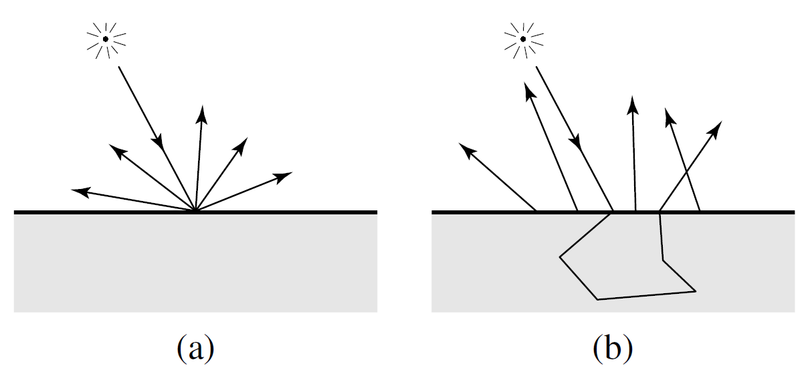

## Participating Media

要模拟这样的现象，最简单，最精确，也是计算量最大，最慢的方法，就是直接在物体内部的空域求解带有 Participating Media 的渲染方程*。为了文章的完整性，这里简单介绍一下 Participating Media 的数学定义，想详细了解可以参考 pbrt 第11章[1]。

Participating Media 的存在，意味着传统的渲染方程不再是传统的以场景中所有表面为定义域的积分，因为光线在有介质的空间中传播的时候，不用和表面接触，也会被空间中的介质所吸收，散射。通常我们用一下几个参数来描述空间中介质的性质。吸收系数 $\sigma_a$，和散射系数 $\sigma_s$。前者描述了空间中每单位长度中光子被吸收的概率，后者则描述了每单位长度中光子被散射、既传播方向被改变的概率。散射系数*包括除了其他方向的光线入射到当前方向的概率，也包括当前方向出射到其他方向的概率。另一个参数是 $\sigma_t = \sigma_a + \sigma_s$，就是衰减系数，它是吸收系数和散射系数的和，代表了单位距离内光子出射到其他方向或者被吸收掉的总概率。所以单位距离内辐射度的变化率可以写成：

$$
\frac{\partial}{\partial t} L_o(p,\omega) = -\sigma_t(p,\omega) L_i(p,-\omega) + \sigma_s(p,\omega) \int_{\mathcal{S}^2} phase(p,-\omega',\omega) L_i(p,\omega')\, d\omega'
$$

第一眼看上去貌似有些吓人，实际上说的就是，在介质中，单位长度上 Radiance 强度的变化会因为被介质吸收而减少，同时一部分能量会随机向外散射出去，最后来自各个其他方向的光线也有一定概率散射到当前方向。其中方程最右边积分中的 phase 是 phase function，可以理解成空间中的BSDF，定义了空间中一点两个方向间发生散射的概率。另一个值得一提的是，每个频率的光线都有对应的系数。也就是说在用RGB渲染时，每个颜色都要有各自的吸收和散射系数。

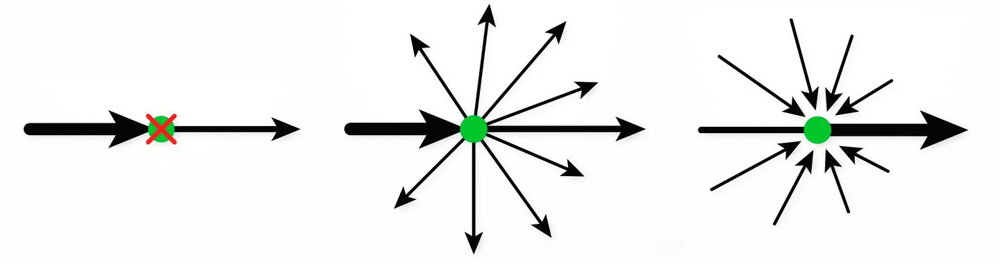

这篇文章封面的图片以及下面这张图都是用直接用模拟 Participating Media 的方法渲染出的玉石。玉石材质是由一个无色的，折射率为1.6的电介质材质表面包裹着绿色散射系数较大的均匀介质。由于下图中介质的散射系数要远大于封面中，所以光线散射的更加频繁，散射间传递的距离更短，导致外观比封面中的玉石更加厚密。

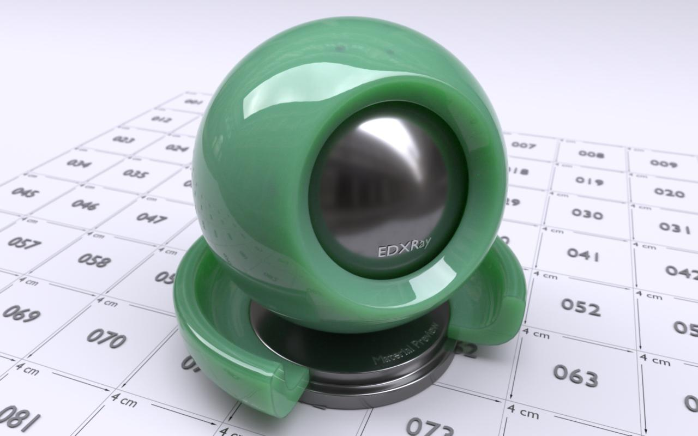

渲染 Participating Media* 的方法有很多，例如最简单的 Volumetric Path Tracing，Volumetric Photon Mapping* 等等。两个参考，[2]是最简单的 Volumetric Path Tracing 的 tutorial，[3]是 State of the art 的 Participating media estimator。因为话题很大，这里不再展开，以后有时间会再专门写写相关的内容。

## BSSRDF的定义

模拟次表面散射的另一大类方法就是通过 BSSRDF（Bidirectional Surface Scattering Reflectance Distribution Function）对材质建模。和BRDF的不同之处在于，BSSRDF可以指定不同的光线入射位置和出射的位置。Jensen在2001年的论文[4]可以说那次表面材质建模最重要的一篇论文，推导了许多重要的物理公式，计算模型，渲染时的参数转换，以及测量了许多生活中常见材质的散射系数等等。大部分后来的论文都是在基于这篇文章中的理论的一些提升。不过这篇论文中有大量的数学以及物理公式，对没有一定数学基础和没有接触过材质建模，体渲染的人来说读起来很快就会摸不着头脑。好在大部分公式的意义都在于推导和证明BSSRDF的计算，所以这篇文章会挑出几个和实现次表面散射直接相关的重要公式简单介绍，如果想了解全部细节，还是请参考[4]原文。

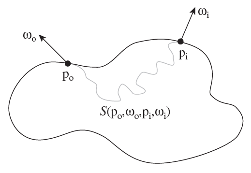

BSSRDF的意义在于快速的近似。对于许多吸收系数特别低，散射系数特别高的材质来说（大部分浑浊的半透明物体例如牛奶，大理石，苹果，肉等等），一束光线会在物体内部散射成千上万次散射，才会彻底被吸收。直接用最暴力的Path Tracing去模拟则意味着每个Sample都需要散射上千次，收敛速度很慢。

对于之前的BRDF来说，一次反射光照的计算是在光线交点的法线半球上的球面积分*。而对于BSSRDF来说，每一次反射在物体表面上每一个位置都要做一次半球面积分，是一个嵌套积分*。

$$
L_o(p_o,\omega_o) = \int_A \int_{\xi_n(p)} S(p_o,\omega_o,p_i,\omega_i) L_i(p_i,\omega_i) |\cos\theta_i|\, d\omega_i\, dA
$$

其中BSSRDF的定义是：

$$
S(p_o,\omega_o,p_i,\omega_i) = \frac{1}{\pi} F_t(\eta_o,\omega_o) R_d(\|p_i - p_o\|) F_t(\eta_i,\omega_i)
$$

其中包括了光纤入射和出射材质表面时候的折射Fresnel*项 $F_t$，一个归一化的 $\frac{1}{\pi}$ 项，和一个diffuse项 $R_d$。除了diffuse项以外，其余的项都非常直观。下面着重说这个diffuse项。首先 $R_d$ 只接受一个标量参数，这个参数的意义是光线入射位置和初设位置的曼哈顿距离*。直观的理解就是，BSSRDF尝试将光线在物体表面内部中数千次的散射后所剩余的能量用一个基于入射点和出射点之间距离的函数去近似。

这个近似既是基于几个假设。第一个假设是，次表面散射的物体是一个曲率为零的平面。第二个假设是，这个平面的厚度，大小都是无限。第三个假设是，平面内部的介质参数是均匀的，最后一个假设是光线永远是从垂直的方向入射表面。正因为有这些假设，所以很容易把出射光的强度与出射点和入射点之间的距离用一个函数去近似。下图是用 unbiased monte carlo 方法模拟的一束光照在平面均匀介质

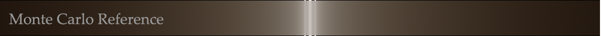

当然实际渲染中这种平面不存在，所有模型都不是无限厚度的，也都是有各种形状的，现实中所有物体内部的散射系数也都肯定不会是均匀的。这也是BSSRDF近似渲染的最主要的错误来源。下图是我在EDXRay里用两种完全不同的方法渲染的颜色，材质以及介质参数完全一样的两个佛像。左边的佛像是基于BSSRDF，右边的则是无偏的Participating Media，两者还是有细微的差别的。BSSRDF因为假设所有表面的厚度都是无限的，在实际模型中如果有厚度比较薄的地方，误差会更为明显。这也是为什么BSSRDF渲染的结果相比Participating Media要暗淡一些。除了这些误差以外，BSSRDF也没办法渲染出焦散*，无法正确的渲染表面以下的几何模型（注意封面shader ball左侧在球内部的写有sub-surface的黑色模型）。

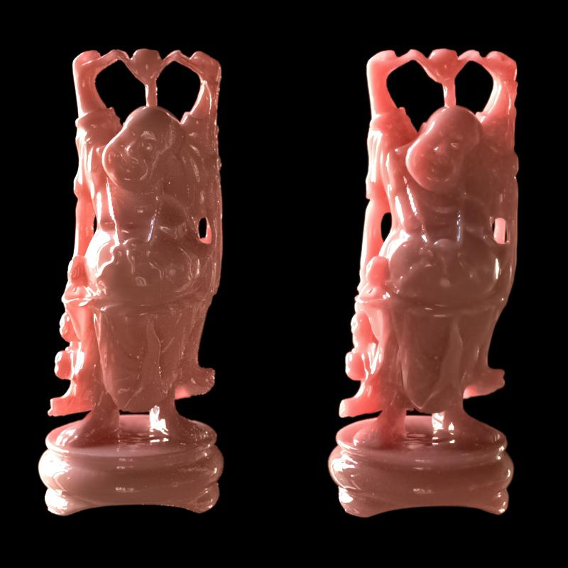

那么究竟 $R_d$ 的定义是什么呢。理论上来说它需要尽可能的只通过离光线入射点的距离就算出出射点的能量。首先在场景及其简化的情况下，例如一个点光源完全被包围在在散射系数均匀的介质中，散射的能量和光源的距离的关系可以用下面的公式算出来。

$$
\phi(r) = \frac{e^{-\sigma_{tr} r}}{4\pi r^2} + \frac{\sigma_s}{2\pi r^2} \int_0^\infty \frac{\arctan^2 u}{u - \alpha \arctan u} \sin(r \sigma_t u)\, du
$$

但是这个积分并没有办法解析的求解，数值方法求得的解也会发散。再加上没有任何公式能直接根据距离准确的计算任何在有限空间内，表面形状任意时候的次表面散射的能量。所以寻求某种近似是必须的。其中一个这些年非常流行的近似算法就是用求解Diffusion方程的方法。

$$
\phi(r) = \frac{1}{4\pi D} \frac{e^{-\sqrt{\frac{\sigma_a}{D}}\, r}}{r},
$$

相比上面的精确解，Diffusion的近似简单了许多，只是一个距离自然指数*除以距离。这个方程也是Jensen 2001[4]中Dipole近似的核心。实际上过去的所有次表面散射相关的论文都在不断的提出新的方法来更准确的理解这个方程的性质和提高它的精确度。

然而这篇文章并不想着重介绍Dipole[4]以及其延伸算法例如Multipole[5]，Directional Dipole[6]。所以读到这也不必太在意上面两个眼花缭乱的公式。

## Normalized Diffusion*

Pixar的Christensen（曾经差点和他成为同事）在去年发表的一篇论文中[7]，试验出了一个函数，它没有基于任何Diffusion或者光线传递的理论，就可以直接比几乎以往所有的算法都更精确的直接逼近介质渲染方程的正确解。不仅如此，这个方程本身只含有两个指数函数，实现和计算都非常简单。而且它还可以的解析的求 Cumulative Distribution Function(CDF)，渲染时要 Importance Sampling 也非常方便。实际上上面红色的佛像就是用这个方法的渲染的。当然它同样也要满足以上提倒的那几个假设。

因为这个函数从0到∞的积分永远是1，所以这个方法的名称叫做Normalized Diffusion。它的定义如下：

$$
R_d(r) = \frac{e^{-r/d} + e^{-r/3d}}{8\pi d r},
$$

就是这么简单。其中 d 是一个控制这个函数形状的参数。我们只需要根据不同的介质散射系数计算出适合的 $d$，就可以非常准确的逼近 Participating Media 的无偏解。下图截自[7]，意思就是说上面那么简单的公式可以做到比传统的数个复杂许多的算法更精确逼近于蒙特卡洛暴力积分的无偏解。A是材质表面的反射率（既RGB值）。注意，原来的Diffusion方法所计算都只包括了介质中的多重散射（Multiple Scattering），直接散射（Single Scattering）则要单独用Ray Marching的方法求解。而Normalized Diffusion在函数里就默认包含了直接散射，实现和计算上都更加简单。

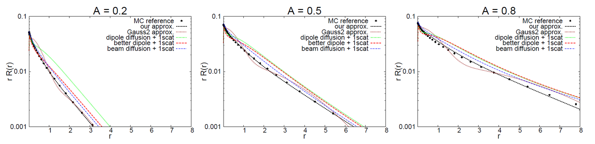

Normalized Diffusion 所接受的介质参数和传统的有所不同。通常描述介质用的是吸收系数 $\sigma_a$，和散射系数 $\sigma_s$。但是由于它们和最终材质外观的联系并不是一个线性关系，下面的表格中可以看出 $\sigma_a$ 和 $\sigma_s$ 与材质的颜色的关系非常摸不着头脑。所以 Artists 并不能很方便的直接调整这些系数。所以其实大部分渲染器都会把这些系数映射成材质表面的 Albedo A 和平均散射距离 $l_d$（diffuse mean free path）供 Artists 调整。不仅如此，也只有这，才可以将纹理上的颜色应用到这次表面散射材质上去。

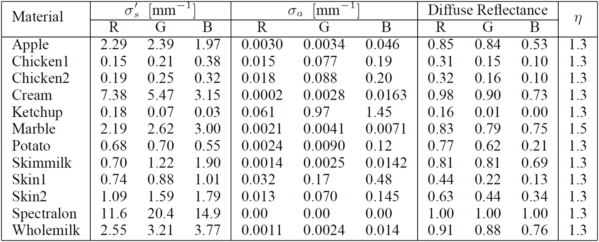

从 Albedo 和平均散射距离到介质系数的映射在[4]中就有介绍。

$$
DiffuseAlbedo = 2\pi \int_0^\infty R_d(r) r\, dr = \frac{\alpha'}{2}\left(1 + e^{-\frac{4}{3}A\sqrt{3(1-\alpha')}}\right) e^{-\sqrt{3(1-\alpha')}}
$$

其中 $\alpha'$ 是 reduced albedo，$\alpha' = \sigma_s'/\sigma_t'$。$\sigma_a'$ 和 $\sigma_s'$ 则是散射系数受到 phase function 影响之后的 reduced scattering coefficient，$\sigma_s' = \sigma_s \times (1-g)$，$\sigma_t' = \sigma_s' + \sigma_a$。A 则和表面的折射率有关，$A = (1 + F_{dr})/(1 - F_{dr})$。$F_{dr} = -\frac{1.44}{\eta^2} + \frac{0.710}{\eta} + 0.668 + 0.0636\eta$。

平均散射距离 $l_d \approx 1/\sigma_{tr}$，$\overline{\omega}\,\sigma_t' = \frac{\sigma_{tr}}{\sqrt{3(1-\alpha')}}$

上面那堆公式就足够能解出材质的散射系数。这里可以看出 Normalized Diffusion 另一个优势是，方程的输入直接就是 Diffuse Albedo 和平均散射距离，不需要求上边那些复杂的公式。

d 值本身的计算，也是通过函数拟合。给定一个材质的反射率 A，以及介质的平均散射距离 $l_d$，再假定光线是以光束的形式垂直射入物体的话，$d = \frac{l_d}{3.5 + 100(A-0.33)^4}$。想了解其他拟合的计算方法，例如光线是以漫射的形式入射表面等，请参考[7]。

因为这里的 $R_d$ 积分时永远等于1，所以渲染的时候只要直接乘以材质的 Diffuse Albedo 就可以了。当平均散射距离为0的时候，会收敛到和漫反射材质一样的结果。下图是五只用 Normalized Diffusion 渲染的兔子，平均散射距离从左到右由小变大。

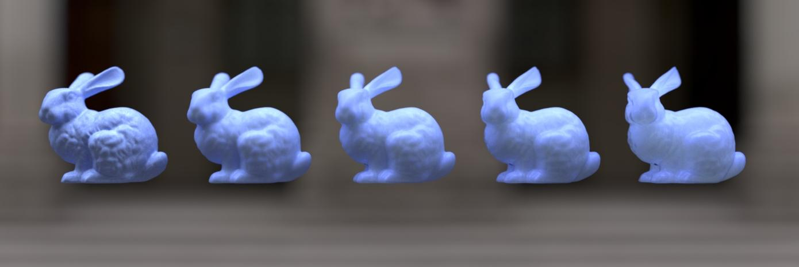

终于，文章写到这里，BSSRDF的公式的定义终于介绍完整了！最后简单的谈谈具体如何用 BSSRDF 进行采样和渲染。

## BSSRDF重要性采样*

利用BSSRDF渲染的方法大致有两种。Jensen在[4]中提出了一种直接在物体的入射点周围根据 $R_d$ 重要性采样出射点的方法。接着Jensen又在[8]中提出了一种基于点云*的方法，先将许多点随机分布在次表面的模型上，然后在每个点预计算 irradiance，最后利用这些点云信息快速查找积分。这个算法的优势是速度比前者快两三个数量级，缺点则额外的内存开销，需要多一个预算的Pass，实现起来较为麻烦，不适合progressive渲染，同时点云的分布影响渲染质量，容易在animation中出现 flickering 等等。

所以这里介绍的方法还是基于直接对BSSRDF进行重要性采样。Solid Angle在2013年提出一个多轴投射的采样方法[9]。首先根据 $R_d$ 在入射点周围的圆盘上根据 $R_d$ 的分布采样一个距离 r，接着将这个点垂直投影到模型的表面上。因为BSSRDF是在物体的表面积上积分，所以在遇到入射点法线方向不同的表面时，样本的pdf需要乘以入射和出射点法线的点积*。当入射与出射表面接近垂直的时候，pdf就会非常小。所以[9]中的做法是用一定的概率在 binormal 和 tangent 方向进行投影，然后用多重重要性采样计算样本的pdf，就可以在凹凸不平的表面达到更快的收敛速度。

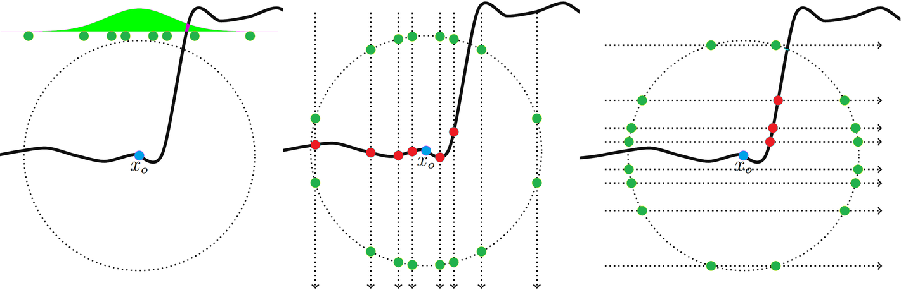

至于对散射距离的采样，Normalized Diffusion 的CDF可以直接用下面的公式计算：

$$
cdf(r) = 1 - \frac{1}{4}e^{-r/d} - \frac{3}{4}e^{-r/3d}.
$$

不过采样需要的 $cdf^{-1}$ 无法解析的表达，这里可以直接用预计算查表的方法解决。计算的时候让 d 等于1，查表时乘以实际的 d 就能得到散射距离。有了以上采样的方法，就可以把次表面散射采样的路径作为一种特殊路径集成到 Path tracing 或者 Bidirectional path tracing 的积分中去。

最后放多几张次表面散射材质的美图。本文中所有渲染结果均使用本人自己开发的渲染器 EDXRay。

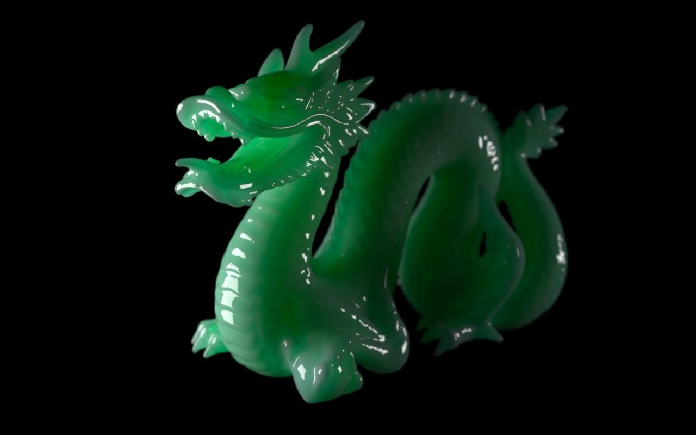

<!-- 原文最后一图（半透明白色兔子）未包含在 文章1图片/ 中，见 sss文章截图/文章1图片/屏幕截图 2026-09-29 154859.png -->

## 参考文献

[1] Physically Based Rendering Matt Pharr and Greg Humphreys* Physically Based Rendering: From Theory to Implementation

[2] http://www.http://cs.cornell.edu/courses/cs6630/2012sp/notes/09volpath.pdf

[3] Jaroslav Křivánek, Iliyan Georgiev, Toshiya Hachisuka, Petr Vévoda, Martin Šik, Derek Nowrouzezahrai, and Wojciech Jarosz. Unifying points, beams, and paths in volumetric light transport simulation*. *ACM* Trans. Graph. 33(4), 2014. (SIGGRAPH 2014) cgg.mff.cuni.cz/~jaroslav/

[4] Henrik Wann Jensen, Stephen R. Marschner, Marc Levoy and Pat Hanrahan: "A Practical Model for Subsurface Light Transport". Proceedings of SIGGRAPH'2001. https://graphics.stanford.edu/papers/bssrdf/bssrdf.pdf

[5] Light Diffusion in Multi-Layered Translucent Materials. Craig Donner Henrik Wann Jensen. University of California, San Diego http://www.http://cs.virginia.edu/~jdl/bib/appearance/subsurface/donner05.pdf

[6] Directional dipole model for subsurface scattering JR Frisvad, T Hachisuka, TK Kjeldsen - ACM Transactions on Graphics http://www.http://cii.u-tokyo.ac.jp/~hachisuka/dipole.pdf

[7] An approximate reflectance profile for efficient subsurface scattering* PH Christensen - ACM SIGGRAPH 2015 Talks http://http://graphics.pixar.com/library/ApproxBSSRDF/paper.pdf

[8] A rapid hierarchical rendering technique for translucent materials HW Jensen, J Buhler - ACM Transactions on Graphics (TOG)*, 2002 http://http://graphics.ucsd.edu/~henrik/papers/fast_bssrdf/fast_bssrdf.pdf

[9] BSSRDF importance sampling A King, C Kulla, A Conty, M Fajardo - ACM SIGGRAPH 2013 Talks http://http://library.imageworks.com/pdfs/imageworks-library-BSSRDF-sampling.pdf
