# Unity 实现 SSS 皮肤次表面散射

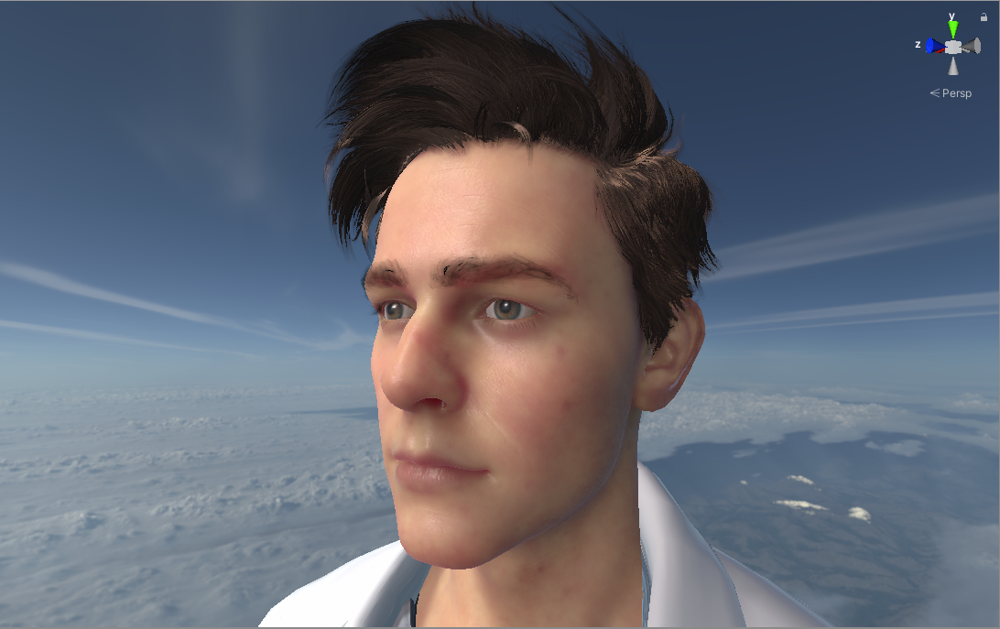

> **作者：** 馒头馍馍亚古兽（科普三角形的农夫）
> **收录于：** Unity 下游哨子 · 86 人赞同了该文章
> 原文来源：知乎（依据文章截图 / 插图 / 文字还原）

---

## 摘要

在游戏中皮肤如果使用普通的BRDF材质往往表现不够红润和通透，因为现实中皮肤结构比较复杂，我们需要引用更加高级的BSSRDF(Bidirectional Surface Scattering Reflectance Distribution Function) 双向表面散射反射分布函数。

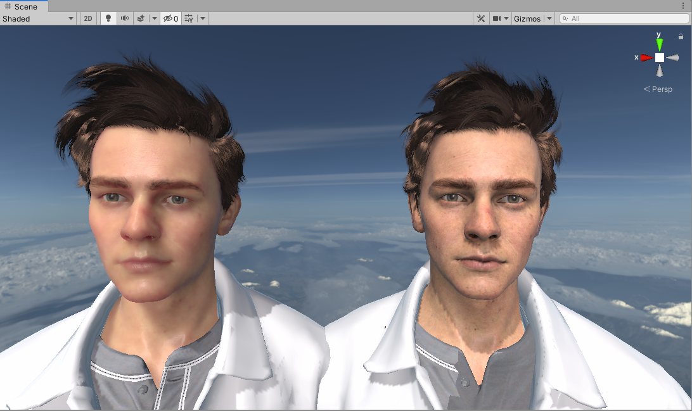

<p align="center">左图加入次表面散射，右图为普通BRDF</p>

## BSSRDF定义

$$
L_o(p_o,\omega_o) = \int_A \int_{\eta_n} S(p_o,\omega_o,p_i,\omega_i) L_i(p_i,\omega_i) |\cos\theta_i| \, d\omega_i \, dA
$$

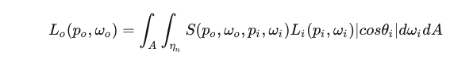

$$
S(p_o,\omega_o,p_i,\omega_i) = \frac{1}{\pi} F_t(\eta_o,\omega_o) R_d(\|p_i - p_o\|) F_t(\eta_i,\omega_i)
$$

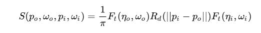

Ft 是两个方向的菲涅尔传输项，Rd 是漫反射剖面。

和BRDF不同，BSSRDF不只要考虑球面上各个方向，因为光线会在物体内部发生若干次散射，然后在某个位置出射，所以公式里除了在物体表面上做一次半球面积分，还要对区域内每个位置作一次积分，是个嵌套的积分。即是需要考虑周围像素对当前着色点的贡献。

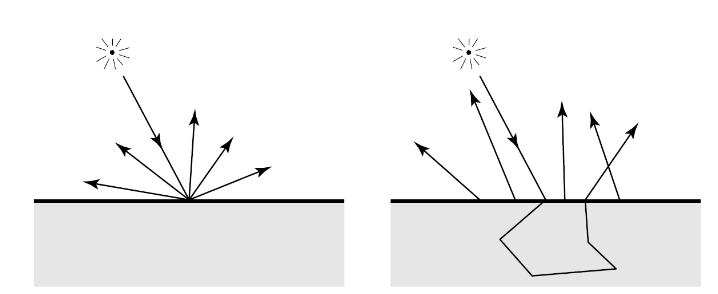

## Diffusion Profile

接下来我们看下公式中的R(r)，其描述了光线是如何进行扩散的。本文将使用Burley Normalized Diffusion近似。

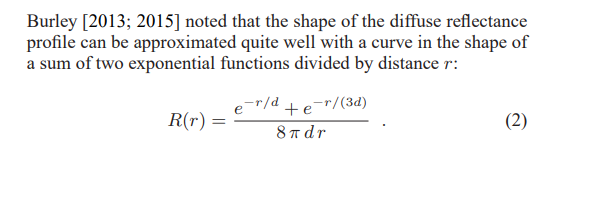

> Burley [2013; 2015] noted that the shape of the diffuse reflectance profile can be approximated quite well with a curve in the shape of a sum of two exponential functions divided by distance *r*:

$$
R(r) = \frac{e^{-r/d} + e^{-r/(3d)}}{8\pi d r} \qquad (2)
$$

d 是可以美术可调节的参数，或基于物理去定义。

HDRP 中是直接暴露 d 给使用者调节的，参数是 ScatteringDistance，本文也适用类似方法。

`Unity d (Shape) = 1 / ScatteringDistance`

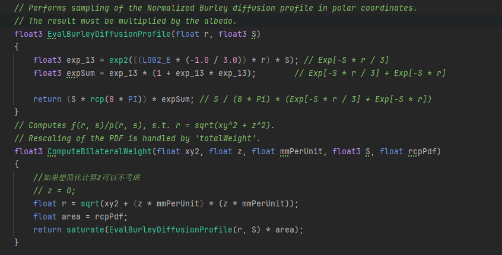

```hlsl
// Performs sampling of the Normalized Burley diffusion profile in polar coordinates.
// The result must be multiplied by the albedo.
float3 EvalBurleyDiffusionProfile(float r, float3 S)
{
    float3 exp_13 = exp2(((LOG2_E * (-1.0 / 3.0)) * r) * S); // Exp[-S * r / 3]
    float3 expSum = exp_13 * (1 + exp_13 * exp_13);        // Exp[-S * r / 3] + Exp[-S * r]

    return (S * rcp(8 * PI)) * expSum; // S / (8 * Pi) * (Exp[-S * r / 3] + Exp[-S * r])
}

// Computes f(r, s)/p(r, s), s.t. r = sqrt(xy^2 + z^2).
// Rescaling of the PDF is handled by 'totalWeight'.
float3 ComputeBilateralWeight(float xy2, float z, float mmPerUnit, float3 S, float rcpPdf)
{
    //如果想简化计算z可以不考虑
    // z = 0;
    float r = sqrt(xy2 + (z * mmPerUnit) * (z * mmPerUnit));
    float area = rcpPdf;
    return saturate(EvalBurleyDiffusionProfile(r, S) * area);
}
```

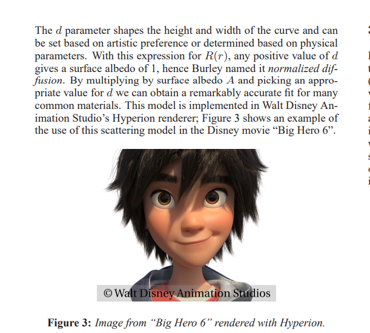

> The *d* parameter shapes the height and width of the curve and can be set based on artistic preference or determined based on physical parameters. With this expression for $R(r)$, any positive value of *d* gives a surface albedo of 1, hence Burley named it *normalized diffusion*. By multiplying by surface albedo *A* and picking an appropriate value for *d* we can obtain a remarkably accurate fit for many common materials. This model is implemented in Walt Disney Animation Studio's Hyperion renderer; Figure 3 shows an example of the use of this scattering model in the Disney movie "Big Hero 6".
>
> **Figure 3:** Image from "Big Hero 6" rendered with Hyperion. © Walt Disney Animation Studios

### d 为物理定义时候

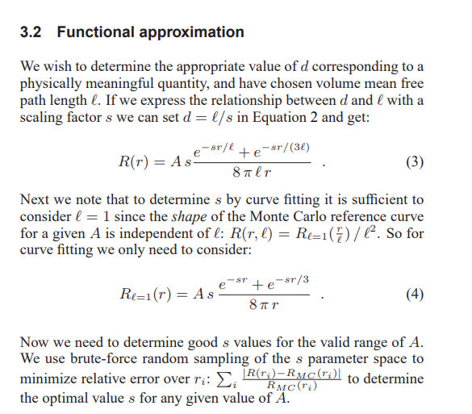

> **3.2 Functional approximation**
>
> We wish to determine the appropriate value of *d* corresponding to a physically meaningful quantity, and have chosen volume mean free path length $\ell$. If we express the relationship between *d* and $\ell$ with a scaling factor *s* we can set $d = \ell / s$ in Equation 2 and get:

$$
R(r) = A s \frac{e^{-sr/\ell} + e^{-sr/(3\ell)}}{8\pi \ell r} \qquad (3)
$$

> Next we note that to determine *s* by curve fitting it is sufficient to consider $\ell = 1$ since the *shape* of the Monte Carlo reference curve for a given *A* is independent of $\ell$: $R(r,\ell) = R_{\ell=1}(\frac{r}{\ell})/\ell^2$. So for curve fitting we only need to consider:

$$
R_{\ell=1}(r) = A s \frac{e^{-sr} + e^{-sr/3}}{8\pi r} \qquad (4)
$$

> Now we need to determine good *s* values for the valid range of *A*. We use brute-force random sampling of the *s* parameter space to minimize relative error over $r_i$: $\sum_i \frac{|R(r_i) - R_{MC}(r_i)|}{R_{MC}(r_i)}$ to determine the optimal value *s* for any given value of *A*.

A : Surface Albedo

UE 中使用的是物理定义的方法: 参数是 Surface Albedo 和 Mean Free Path。

## 蒙特卡洛积分

因为这个函数在 0，无穷区间的积分是1，PDF 和 CDF 都可以求出，我们可以在实时渲染中使用蒙特卡洛积分和重要性采样来计算次表面散射了。

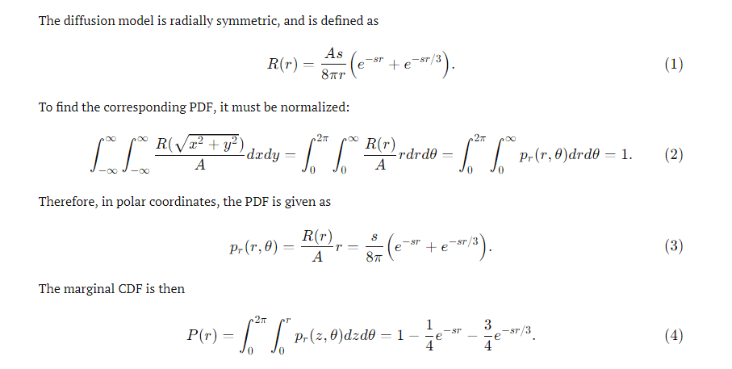

> The diffusion model is radially symmetric, and is defined as

$$
R(r) = \frac{As}{8\pi r}\left(e^{-sr} + e^{-sr/3}\right) \qquad (1)
$$

> To find the corresponding PDF, it must be normalized:

$$
\int_{-\infty}^{\infty}\int_{-\infty}^{\infty} \frac{R(\sqrt{x^2+y^2})}{A} dxdy = \int_0^{2\pi}\int_0^{\infty} \frac{R(r)}{A} r\, dr\, d\theta = \int_0^{2\pi}\int_0^{\infty} p_r(r,\theta)\, dr\, d\theta = 1 \qquad (2)
$$

> Therefore, in polar coordinates, the PDF is given as

$$
p_r(r,\theta) = \frac{R(r)}{A} r = \frac{s}{8\pi}\left(e^{-sr} + e^{-sr/3}\right) \qquad (3)
$$

> The marginal CDF is then

$$
P(r) = \int_0^{2\pi}\int_0^{r} p_r(z,\theta)\, dz\, d\theta = 1 - \frac{1}{4}e^{-sr} - \frac{3}{4}e^{-sr/3} \qquad (4)
$$

关于如何使用pdf和cdf实现重要性采样可以参考之前PBR的内容。

> 🔗 **Unity的URP实现PBR** — 109 赞同 · 7 评论 · 文章

这里简单复习一下：在 [0,1] 均匀地随机出大量的随机数，通过先求出 cdf(累计分布函数)，把随机数代入 cdf 的反函数，就能随机出服从 pdf 的分布的随机散射距离 r，获得 r 后作为以原盘中心的半径进行随机角度的采样。

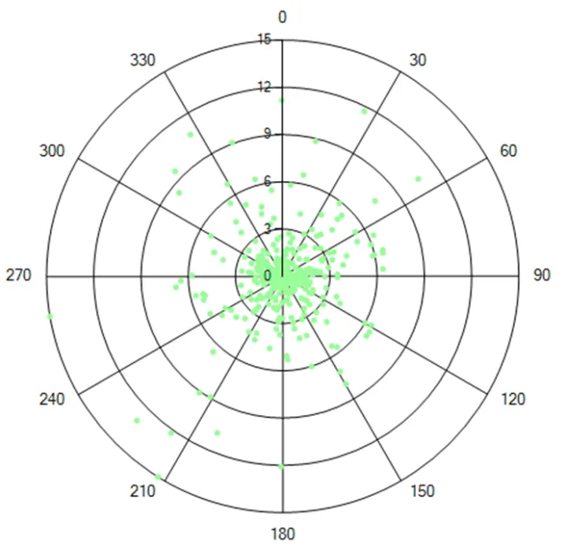

## 实现流程

下面我们开始在 URP 实践一下(参考HDRP)，为了简单起见我们把漫反射和深度部分先输出到一张颜色 RT 和深度 RT 上。

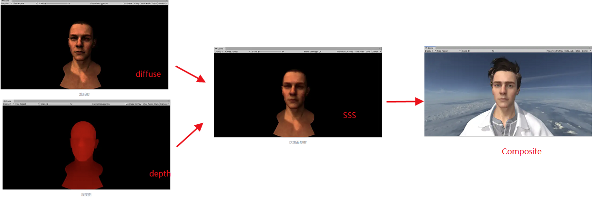

### Diffuse

输出漫反射(所有光源)到 DiffuseRT，和深度：

$$
L_o(p,\omega_o) = k_d \frac{c}{\pi} \int_\Omega L_i(p,\omega_i) \, n \cdot \omega_i \, d\omega_i
$$

<p align="center">漫反射</p>

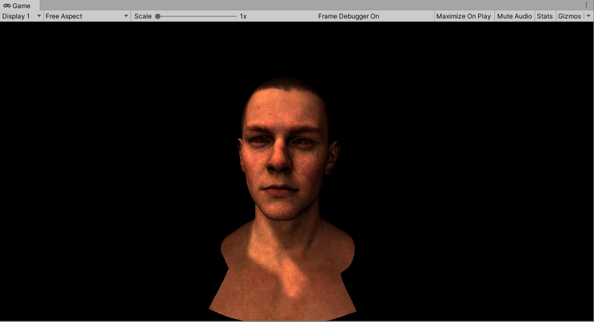

<p align="center">漫反射</p>

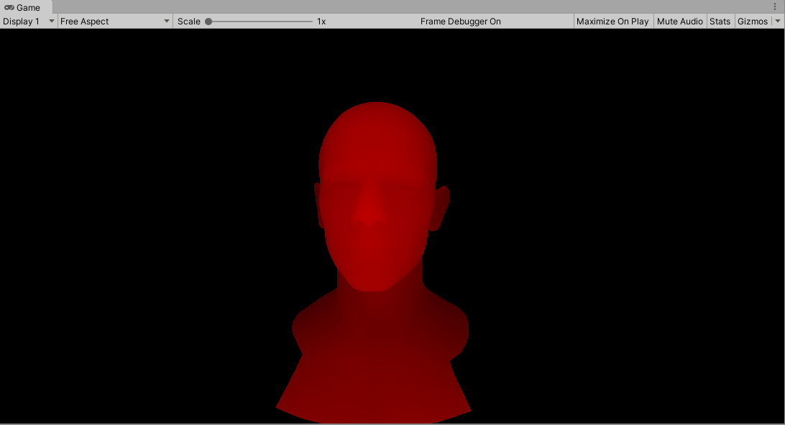

<p align="center">深度图</p>

本文计算漫反射的方案叫 **Pre-Scatter Texturing**，直接 diffuse 贴图 * 灯光漫反射作为输出。缺点是在后续计算SSS的时候把高频细节模糊掉。

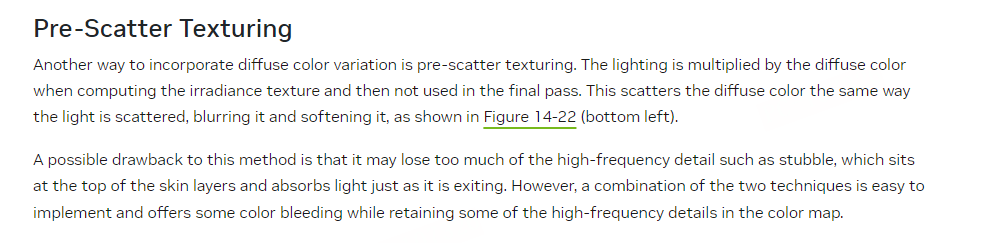

> **Pre-Scatter Texturing**
>
> Another way to incorporate diffuse color variation is pre-scatter texturing. The lighting is multiplied by the diffuse color when computing the irradiance texture and then not used in the final pass. This scatters the diffuse color the same way the light is scattered, blurring it and softening it, as shown in Figure 14-22 (bottom left).
>
> A possible drawback to this method is that it may lose too much of the high-frequency detail such as stubble, which sits at the top of the skin layers and absorbs light just as it is exiting. However, a combination of the two techniques is easy to implement and offers some color bleeding while retaining some of the high-frequency details in the color map.

还有一种方案叫 **Post-Scatter Texturing** 不直接作用 Diffuse 的贴图颜色，只计算入射灯光的漫反射部分。这样可以保留细节。

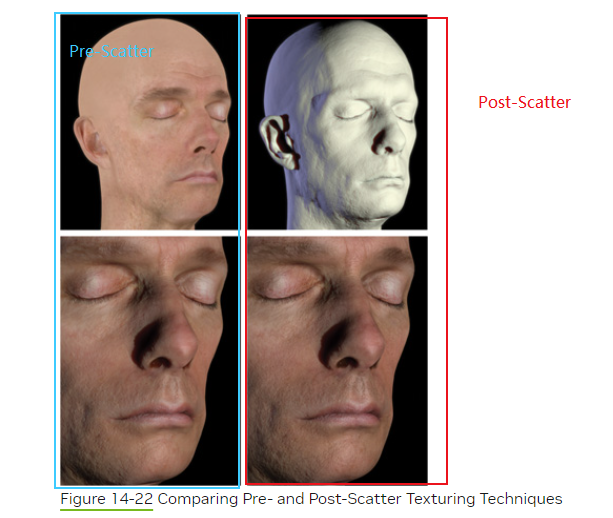

<p align="center">Figure 14-22 Comparing Pre- and Post-Scatter Texturing Techniques</p>

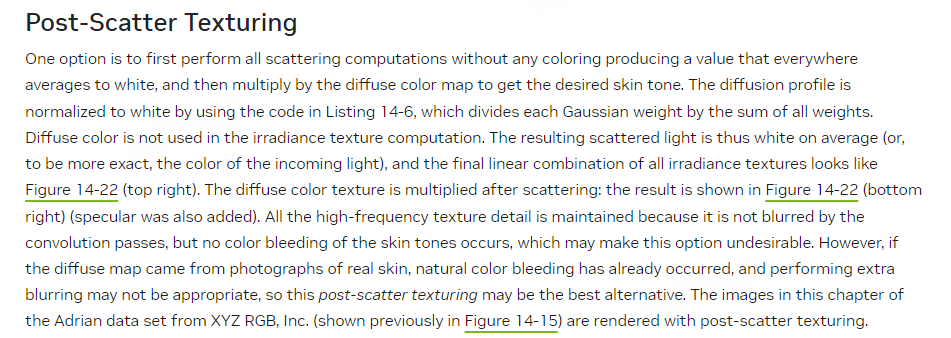

> **Post-Scatter Texturing**
>
> One option is to first perform all scattering computations without any coloring producing a value that everywhere averages to white, and then multiply by the diffuse color map to get the desired skin tone. The diffusion profile is normalized to white by using the code in Listing 14-6, which divides each Gaussian weight by the sum of all weights. Diffuse color is not used in the irradiance texture computation. The resulting scattered light is thus white on average (or, to be more exact, the color of the incoming light), and the final linear combination of all irradiance textures looks like Figure 14-22 (top right). The diffuse color texture is multiplied after scattering; the result is shown in Figure 14-22 (bottom right) (specular was also added). All the high-frequency texture detail is maintained because it is not blurred by the convolution passes, but no color bleeding of the skin tones occurs, which may make this option undesirable. However, if the diffuse map came from photographs of real skin, natural color bleeding has already occurred, and performing extra blurring may not be appropriate, so this post-scatter texturing may be the best alternative. The images in this chapter of the Adrian data set from XYZ RGB, Inc. (shown previously in Figure 14-15) are rendered with post-scatter texturing.

还有一种是两者结合的做法，使用 `Pow(diffuseColor, mix)` 和 `Pow(diffuseColor, 1 - mix)` 来结合，mix 一般取 0.5 有较好效果。

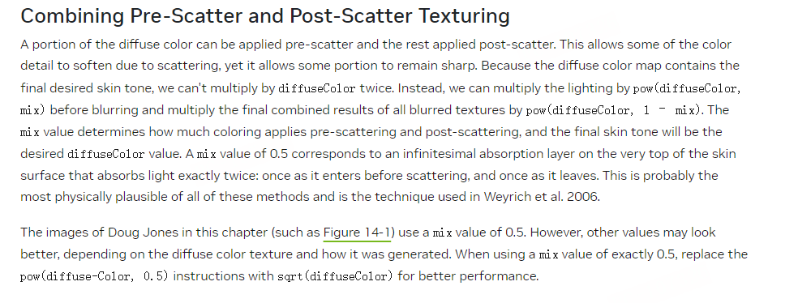

> **Combining Pre-Scatter and Post-Scatter Texturing**
>
> A portion of the diffuse color can be applied pre-scatter and the rest applied post-scatter. This allows some of the color detail to soften due to scattering, yet it allows some portion to remain sharp. Because the diffuse color map contains the final desired skin tone, we can't multiply by diffuseColor twice. Instead, we can multiply the lighting by `pow(diffuseColor, mix)` before blurring and multiply the final combined results of all blurred textures by `pow(diffuseColor, 1 - mix)`. The mix value determines how much coloring applies pre-scattering and post-scattering, and the final skin tone will be the desired diffuseColor value. A mix value of 0.5 corresponds to an infinitesimal absorption layer on the very top of the skin surface that absorbs light exactly twice: once as it enters before scattering, and once as it leaves. This is probably the most physically plausible of all of these methods and is the technique used in Weyrich et al. 2006.
>
> The images of Doug Jones in this chapter (such as Figure 14-1) use a mix value of 0.5. However, other values may look better, depending on the diffuse color texture and how it was generated. When using a mix value of exactly 0.5, replace the `pow(diffuseColor, 0.5)` instructions with `sqrt(diffuseColor)` for better performance.

对应 HDRP 代码：

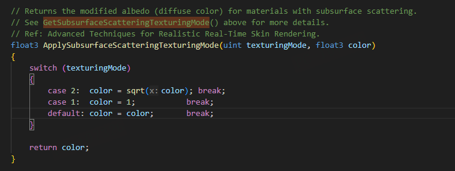

```hlsl
// Returns the modified albedo (diffuse color) for materials with subsurface scattering.
// See GetSubsurfaceScatteringTexturingMode() above for more details.
// Ref: Advanced Techniques for Realistic Real-Time Skin Rendering.
float3 ApplySubsurfaceScatteringTexturingMode(uint texturingMode, float3 color)
{
    switch (texturingMode)
    {
        case 2:  color = sqrt(color); break;
        case 1:  color = 1;           break;
        default: color = color;       break;
    }

    return color;
}
```

### Subsurface Scattering

根据 DiffuseRT(漫反射)计算次表面散射，输出到 SSSRT：

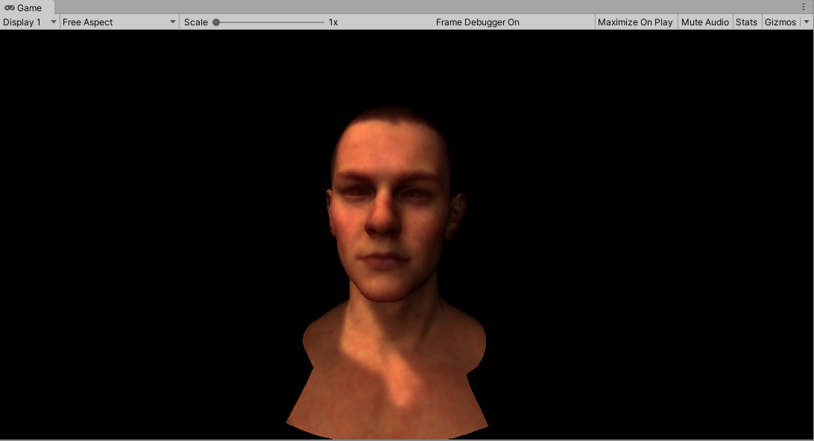

<p align="center">次表面散射</p>

### Composite

最后在绘制场景时，绘制皮肤时再使用屏幕坐标采样次表面 RT，加上高光就是最后效果。

`最终着色 = 采样SSSRT + 高光(所有光源)`

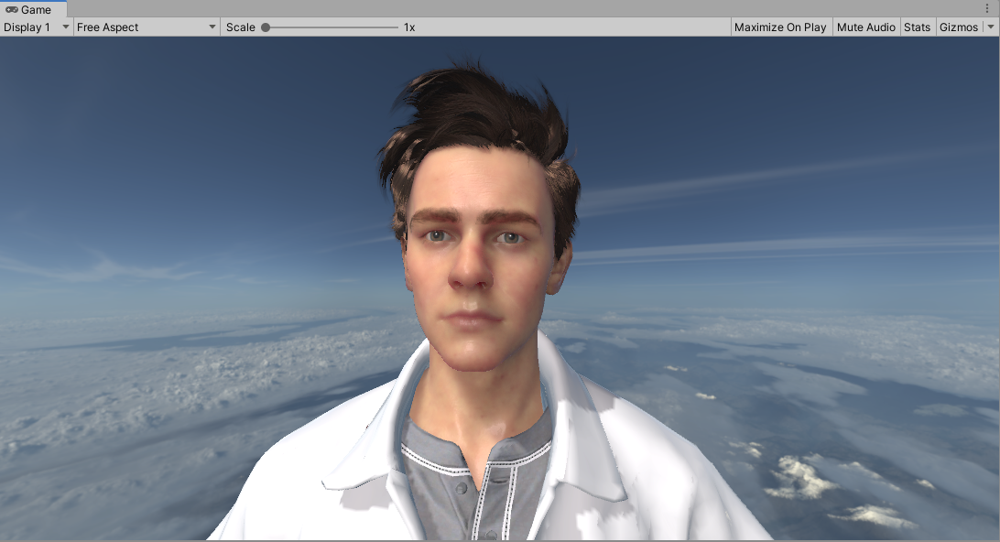

<p align="center">最终效果</p>

---

## 代码

### Pass1

这个 Pass 对应 Diffuse 部分

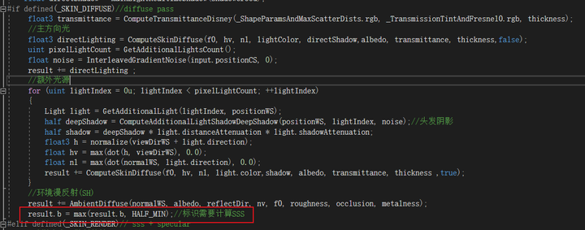

```hlsl
//肤色漫反射
half3 transmittance = ComputeTransmittanceDisney(_ShapeParamsAndMaxScatterDists.rgb, _TransmissionTintAndFresnel0.rgb, thickness);
//主方向光
float3 directLighting = ComputeSkinDiffuse(f0, hv, nl, lightColor, directShadow, albedo, transmittance, thickness, false);
uint pixelLightCount = GetAdditionalLightsCount();
float noise = InterleavedGradientNoise(input.positionCS, 0);
result = directLighting;
//额外光源
for (uint lightIndex = 0u; lightIndex < pixelLightCount; ++lightIndex)
{
    Light light = GetAdditionalLight(lightIndex, positionWS);
    half deepShadow = ComputeAdditionalLightShadowDeepShadow(positionWS, lightIndex, noise);//头发阴影
    half shadow = deepShadow * light.distanceAttenuation * light.shadowAttenuation;
    float3 h = normalize(viewDirWS + light.direction);
    float hv = max(dot(h, viewDirWS), 0.0);
    float nl = max(dot(normalWS, light.direction), 0.0);
    result += ComputeSkinDiffuse(f0, hv, nl, light.color, shadow, albedo, transmittance, thickness, true);
}
//环境漫反射(SH)
result += AmbientDiffuse(normalWS, albedo, reflectDir, nv, f0, roughness, occlusion, metalness);
result.b = max(result.b, HALF_MIN); //标识需要计算SSS
```

这里 Diffuse 还包括了透射部分 : DiffT

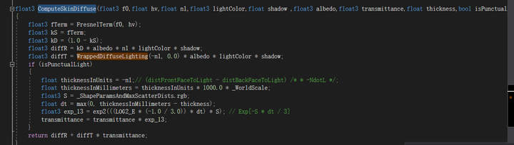

```hlsl
float3 ComputeSkinDiffuse(float3 f0, float hv, float nl, float3 lightColor, float shadow, float3 albedo, float3 transmittance, float thickness, bool isPunctual)
{
    float3 fTerm = FresnelTerm(f0, hv);
    float3 kS = fTerm;
    float3 kD = (1.0 - kS);
    float3 diffR = kD * albedo * nl * lightColor * shadow;
    float3 diffT = WrappedDiffuseLighting(-nl, 0.0) * albedo * lightColor * shadow;
    if (isPunctualLight)
    {
        //额外光源的透射需要计算厚度
        float thicknessInUnits = -nl; // (distFrontFaceToLight - distBackFaceToLight) /** -NdotL */;
        float thicknessInMillimeters = thicknessInUnits * 1000.0 * _WorldScale;
        float3 S = _ShapeParamsAndMaxScatterDists.rgb;
        float dt = max(0, thicknessInMillimeters - thickness);
        float3 exp_13 = exp2(((LOG2_E * (-1.0 / 3.0)) * dt) * S); // Exp[-S * dt / 3]
        transmittance = transmittance * exp_13;
    }

    return diffR + diffT * transmittance;
}
```

透射的部分，HDRP 中透射部分是通过 LightWrap 实现的(其实就是一个 -N·L 的背光)，对于额外光源还会采样阴影图计算光空间的最近点和着色点的距离来评估出一个厚度，用来作为光线的传统距离，但这里因为简化实现过程使用 -N·L 来模拟(即假设越背光，越厚。。)

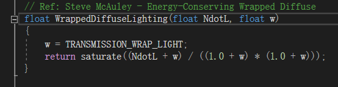

```hlsl
// Ref: Steve McAuley - Energy-Conserving Wrapped Diffuse
float WrappedDiffuseLighting(float NdotL, float w)
{
    w = TRANSMISSION_WRAP_LIGHT;
    return saturate((NdotL + w) / ((1.0 + w) * (1.0 + w)));
}
```

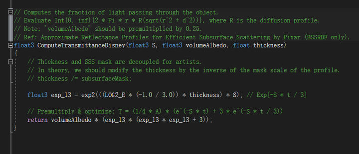

```hlsl
// Computes the fraction of light passing through the object.
// Evaluate Int_{0}^{`2 * Pi * r * R(sqrt(r 2 + d 2))`}, where R is the diffusion profile.
// Note: 'volumeAlbedo' should be premultiplied by 0.25.
// Ref: Approximate Reflectance Profiles for Efficient Subsurface Scattering by Pixar (BSSRDF only).
float3 ComputeTransmittanceDisney(float3 S, float3 volumeAlbedo, float thickness)
{
    // Thickness and SSS mask are decoupled for artists.
    // In theory, we should modify the thickness by the inverse of the mask scale of the profile.
    // thickness /= subsurfaceMask;

    float3 exp_13 = exp2(((LOG2_E * (-1.0 / 3.0)) * thickness) * S); // Exp[-S * t / 3]

    // Premultiply & optimize: T = (1/4 * A) * (e^(-S * t) + 3 * e^(-S * t / 3))
    return volumeAlbedo * (exp_13 * (exp_13 * exp_13 + 3));
}
```

### Pass2

有了漫反射就可以计算次表面散射了:

```csharp
using UnityEngine;
using UnityEngine.Rendering;
using UnityEngine.Rendering.Universal;

public class SkinRenderFeature : ScriptableRendererFeature
{
    public Material sssMat;
    [ColorUsage(false, true)]
    public Color scatteringDistance = Color.black;
    [ColorUsage(false, true)]
    public Color transmissionTint = Color.black; 
    public Vector2 thicknessRemap = new Vector2(1f,5f); 
    public float worldScale = 1f;          
    public float ior = 1.4f;                        // 1.4 for skin (mean ~0.028)
    class SkinRenderPass : ScriptableRenderPass
    {
        public SkinRenderPass(SkinRenderFeature f) 
        {
            this.feature = f;
        }
        int[] diffuseRT;
        SkinRenderFeature feature;
        const string m_ProfilerTag = "Skin Diffuse";
        // This method is called before executing the render pass.
        // It can be used to configure render targets and their clear state. Also to create temporary render target textures.
        // When empty this render pass will render to the active camera render target.
        // You should never call CommandBuffer.SetRenderTarget. Instead call <c>ConfigureTarget</c> and <c>ConfigureClear</c>.
        // The render pipeline will ensure target setup and clearing happens in an performance manner.
        int w, h;
        public override void Configure(CommandBuffer cmd, RenderTextureDescriptor cameraTextureDescriptor)
        {
            w = cameraTextureDescriptor.width;
            h = cameraTextureDescriptor.height;
            if (diffuseRT == null)
            {
                diffuseRT = new int[3];
                diffuseRT[0] = Shader.PropertyToID("_SkinDiffuse");
                diffuseRT[1] = Shader.PropertyToID("_SkinDepth");
                diffuseRT[2] = Shader.PropertyToID("_SkinSSS");
            }
            cmd.GetTemporaryRT(diffuseRT[0], cameraTextureDescriptor.width, cameraTextureDescriptor.height, 0,FilterMode.Bilinear,RenderTextureFormat.ARGBHalf);
            cmd.GetTemporaryRT(diffuseRT[1], cameraTextureDescriptor.width, cameraTextureDescriptor.height, 16, FilterMode.Point, RenderTextureFormat.Depth);
            cmd.GetTemporaryRT(diffuseRT[2], cameraTextureDescriptor.width, cameraTextureDescriptor.height, 0, FilterMode.Bilinear, RenderTextureFormat.ARGBHalf);
        }


        static readonly ShaderTagId SkinDiffuseShaderTagId = new ShaderTagId("SkinDiffuse");
        FilteringSettings m_FilteringSettings = new FilteringSettings(RenderQueueRange.all);

        // https://zero-radiance.github.io/post/sampling-diffusion/
        // Performs sampling of a Normalized Burley diffusion profile in polar coordinates.
        // 'u' is the random number (the value of the CDF): [0, 1).
        // rcp(s) = 1 / ShapeParam = ScatteringDistance.
        // Returns the sampled radial distance, s.t. (u = 0 -> r = 0) and (u = 1 -> r = Inf).
        static float SampleBurleyDiffusionProfile(float u, float rcpS)
        {
            u = 1 - u; // Convert CDF to CCDF

            float g = 1 + (4 * u) * (2 * u + Mathf.Sqrt(1 + (4 * u) * u));
            float n = Mathf.Pow(g, -1.0f / 3.0f);                      // g^(-1/3)
            float p = (g * n) * n;                                   // g^(+1/3)
            float c = 1 + p + n;                                     // 1 + g^(+1/3) + g^(-1/3)
            float x = 3 * Mathf.Log(c / (4 * u));

            return x * rcpS;
        }
      
     
        public override void Execute(ScriptableRenderContext context, ref RenderingData renderingData)
        {
            //RGB散射距离,作为参数调节
            Color scatteringDistance =  feature.scatteringDistance;
            Vector3 shapeParam = new Vector3(Mathf.Min(16777216, 1.0f / scatteringDistance.r),
                Mathf.Min(16777216, 1.0f / scatteringDistance.g),
                Mathf.Min(16777216, 1.0f / scatteringDistance.b));

            //通过0.997f的cdf计算出最大的散射范围
            float maxScatteringDistance = Mathf.Max(scatteringDistance.r, scatteringDistance.g, scatteringDistance.b);
            float cdf = 0.997f;
            float filterRadius = SampleBurleyDiffusionProfile(cdf, maxScatteringDistance);

            CommandBuffer cmd = CommandBufferPool.Get(m_ProfilerTag);
            //透射部分的参数
            float fresnel0 = (feature.ior - 1.0f) / (feature.ior + 1.0f);
            fresnel0 *= fresnel0; // square
            Vector4 transmissionTintAndFresnel0 = new Vector4(feature.transmissionTint.r * 0.25f, feature.transmissionTint.g * 0.25f, feature.transmissionTint.b * 0.25f,
                fresnel0);
            cmd.SetGlobalVector("_TransmissionTintAndFresnel0", transmissionTintAndFresnel0);
            cmd.SetGlobalVector("_ThickRemap",new Vector4(feature.thicknessRemap.x, feature.thicknessRemap.y- feature.thicknessRemap.x, 0,0));
            //次表面散射部分的参数
            cmd.SetGlobalFloat("_FilterRadii", filterRadius);
            cmd.SetGlobalVector("_ShapeParamsAndMaxScatterDists", new Vector4(shapeParam.x, shapeParam.y, shapeParam.z,maxScatteringDistance));
            var projectMatrix = renderingData.cameraData.camera.projectionMatrix;
            var invProject = projectMatrix.inverse; //vp矩阵
            cmd.SetGlobalFloat("_WorldScale", feature.worldScale);
            cmd.SetGlobalMatrix("_InvProjectMatrix", invProject);
            cmd.SetViewProjectionMatrices(renderingData.cameraData.GetViewMatrix(), renderingData.cameraData.GetProjectionMatrix());
            cmd.SetViewport(new Rect(0f, 0f, w,h));
            //设置漫反射RT和深度图RenderTarget
            cmd.SetRenderTarget(new RenderTargetIdentifier(diffuseRT[0]), new RenderTargetIdentifier(diffuseRT[1]));
            cmd.ClearRenderTarget(true, true, Color.clear);
            context.ExecuteCommandBuffer(cmd);
            cmd.Clear();
            var diffuseSetting = CreateDrawingSettings(SkinDiffuseShaderTagId, ref renderingData, SortingCriteria.None);
            //绘制漫反射的Pass
            context.DrawRenderers(renderingData.cullResults, ref diffuseSetting, ref m_FilteringSettings);
            //设置次表面散射RT
            cmd.SetRenderTarget(new RenderTargetIdentifier(diffuseRT[2]));
            cmd.SetViewProjectionMatrices(Matrix4x4.identity, Matrix4x4.identity);
            //执行次表面散射计算
            cmd.DrawMesh(RenderingUtils.fullscreenMesh, Matrix4x4.identity, feature.sssMat, 0, 0);
            cmd.SetViewProjectionMatrices(renderingData.cameraData.GetViewMatrix(), renderingData.cameraData.GetProjectionMatrix());
            context.ExecuteCommandBuffer(cmd);
            CommandBufferPool.Release(cmd);
        }

        /// Cleanup any allocated resources that were created during the execution of this render pass.
        public override void FrameCleanup(CommandBuffer cmd)
        {
            cmd.ReleaseTemporaryRT(diffuseRT[0]);
            cmd.ReleaseTemporaryRT(diffuseRT[1]);
            cmd.ReleaseTemporaryRT(diffuseRT[2]);
        }
    }

    SkinRenderPass m_ScriptablePass;

    public override void Create()
    {
        m_ScriptablePass = new SkinRenderPass(this);
        m_ScriptablePass.renderPassEvent = RenderPassEvent.AfterRenderingShadows + 1;
    }


    public override void AddRenderPasses(ScriptableRenderer renderer, ref RenderingData renderingData)
    {
        renderer.EnqueuePass(m_ScriptablePass);
    }
}
```

设置的参数需要结合 Shader 一起看，下面贴出 Pass2 的计算次表面散射 Shader 代码。

```hlsl
Shader "Hidden/Subsurface Scattering"
{
    SubShader
    {
        Tags{ "RenderPipeline" = "UniversalPipeline" "IgnoreProjector" = "True"}

        HLSLINCLUDE

        // Note: Screenspace shadow resolve is only performed when shadow cascades are enabled
        // Shadow cascades require cascade index and shadowCoord to be computed on pixel.
        #pragma prefer_hlslcc gles
        #pragma exclude_renderers d3d11_9x
        //Keep compiler quiet about Shadows.hlsl.
        #include "Packages/com.unity.render-pipelines.core/ShaderLibrary/Common.hlsl"
        #include "Packages/com.unity.render-pipelines.core/ShaderLibrary/EntityLighting.hlsl"
        #include "Packages/com.unity.render-pipelines.core/ShaderLibrary/ImageBasedLighting.hlsl"
        #include "Packages/com.unity.render-pipelines.universal/ShaderLibrary/Core.hlsl"
        #include "Packages/com.unity.render-pipelines.universal/ShaderLibrary/Shadows.hlsl"
        #include "Packages/com.unity.render-pipelines.core/ShaderLibrary/Color.hlsl"


        TEXTURE2D_FLOAT(_SkinDepth);
        SAMPLER(sampler_SkinDepth);
        float4 _SkinDepth_TexelSize;


        TEXTURE2D(_SkinDiffuse);
        SAMPLER(sampler_SkinDiffuse);

        float4 _ShapeParamsAndMaxScatterDists;
        float4 _WorldScalesAndFilterRadiiAndThicknessRemaps;
        float4x4 _InvProjectMatrix;
        float _WorldScale;
        struct Attributes
        {
            float4 positionOS   : POSITION;
            UNITY_VERTEX_INPUT_INSTANCE_ID
        };

        struct Varyings
        {
            float4  positionCS   : SV_POSITION;
            float4 uv :TEXCOORD0;
            UNITY_VERTEX_OUTPUT_STEREO
        };

        void SampleBurleyDiffusionProfile(float u, float rcpS, out float r, out float rcpPdf)
        {
            u = 1 - u; // Convert CDF to CCDF

            float g = 1 + (4 * u) * (2 * u + sqrt(1 + (4 * u) * u));
            float n = exp2(log2(g) * (-1.0 / 3.0));                    // g^(-1/3)
            float p = (g * n) * n;                                   // g^(+1/3)
            float c = 1 + p + n;                                     // 1 + g^(+1/3) + g^(-1/3)
            float d = (3 / LOG2_E * 2) + (3 / LOG2_E) * log2(u);     // 3 * Log[4 * u]
            float x = (3 / LOG2_E) * log2(c) - d;                    // 3 * Log[c / (4 * u)]

            // x      = s * r
            // exp_13 = Exp[-x/3] = Exp[-1/3 * 3 * Log[c / (4 * u)]]
            // exp_13 = Exp[-Log[c / (4 * u)]] = (4 * u) / c
            // exp_1  = Exp[-x] = exp_13 * exp_13 * exp_13
            // expSum = exp_1 + exp_13 = exp_13 * (1 + exp_13 * exp_13)
            // rcpExp = rcp(expSum) = c^3 / ((4 * u) * (c^2 + 16 * u^2))
            float rcpExp = ((c * c) * c) * rcp((4 * u) * ((c * c) + (4 * u) * (4 * u)));

            r = x * rcpS;
            rcpPdf = (8 * PI * rcpS) * rcpExp; // (8 * Pi) / s / (Exp[-s * r / 3] + Exp[-s * r])
        }
     
        float2 SampleDiskGolden(uint i, uint sampleCount)
        {
            float2 f = Golden2dSeq(i, sampleCount);
            return float2(sqrt(f.x), TWO_PI * f.y);
        }
        // Performs sampling of the Normalized Burley diffusion profile in polar coordinates.
        // The result must be multiplied by the albedo.
        float3 EvalBurleyDiffusionProfile(float r, float3 S)
        {
            float3 exp_13 = exp2(((LOG2_E * (-1.0 / 3.0)) * r) * S); // Exp[-S * r / 3]
            float3 expSum = exp_13 * (1 + exp_13 * exp_13);        // Exp[-S * r / 3] + Exp[-S * r]

            return (S * rcp(8 * PI)) * expSum; // S / (8 * Pi) * (Exp[-S * r / 3] + Exp[-S * r])
        }
        // Computes f(r, s)/p(r, s), s.t. r = sqrt(xy^2 + z^2).
        // Rescaling of the PDF is handled by 'totalWeight'.
        float3 ComputeBilateralWeight(float xy2, float z, float mmPerUnit, float3 S, float rcpPdf)
        {
            //如果想简化计算z可以不考虑
            // z = 0;
            float r = sqrt(xy2 + (z * mmPerUnit) * (z * mmPerUnit));
            float area = rcpPdf;
            return saturate(EvalBurleyDiffusionProfile(r, S) * area);
        }

        Varyings Vertex(Attributes input)
        {
            Varyings output;
            UNITIALIZE_VERTEX_OUTPUT_STEREO(output);

            output.positionCS = TransformObjectToHClip(input.positionOS.xyz);
            float4 cs = output.positionCS / output.positionCS.w;
            output.uv = ComputeScreenPos(cs);

            return output;
        }
        float _FrameCount;
        float _FilterRadii;
        //4像素一个采样点
        #define SSS_PIXELS_PER_SAMPLE 4
 
        half4 Fragment(Varyings input) : SV_Target
        {
            UNITY_SETUP_STEREO_EYE_INDEX_POST_VERTEX(input);
            float2 uv = input.uv.xy/ input.uv.w;
            float2 posSS = uv * _SkinDepth_TexelSize.zw;
            float depth = SAMPLE_TEXTURE2D_X(_SkinDepth, sampler_SkinDepth, uv).r;
            float linearDepth = LinearEyeDepth(depth, _ZBufferParams);
            float2 cornerPosNDC = uv + 0.5*_SkinDepth_TexelSize.xy;
#if UNITY_REVERSED_Z
            depth = 1 - depth;
#endif
            depth = 2 * depth - 1;

            float3 centerPosVS = ComputeViewSpacePosition(uv, depth, _InvProjectMatrix);
            float3 cornerPosVS = ComputeViewSpacePosition(cornerPosNDC, depth, _InvProjectMatrix);
            float mmPerUnit = 1000.0;
            float unitsPerMm = rcp(mmPerUnit);
            float worldScale = _WorldScale ;
            float unitsPerPixel = max(0.0001f, 2.0 * abs(cornerPosVS.x - centerPosVS.x)) * worldScale;//一个像素覆盖多少米
            float pixelsPerMm = rcp(unitsPerPixel) * unitsPerMm;//1毫米覆盖多少个像素
            //SSS散射最大距离(单位毫米) 
            //已经预先在C#计算好
            float  filterRadius = _FilterRadii;
            float filterArea = PI * Sq(filterRadius * pixelsPerMm);//圆盘上覆盖多少个像素
            
            uint sampleCount = (uint)(filterArea / (SSS_PIXELS_PER_SAMPLE));//圆盘上有多少个采样点
            uint sampleBudget = (uint)32;
            uint n = min(sampleCount, sampleBudget);
            float3 S = _ShapeParamsAndMaxScatterDists.rgb;
            float d = _ShapeParamsAndMaxScatterDists.a;
            float2  pixelCoord = posSS;
            float3 totalIrradiance = 0;
            float3 totalWeight = 0;
     
            //根据屏幕坐标生成一个随机角度
            float phase = TWO_PI * GenerateHashedRandomFloat(uint3(posSS, (uint)(depth * 16777216)));
            for (uint i = 0; i < n; i++)
            {
                 float scale = rcp(n);
                 float offset = rcp(n) * 0.5;

                float sinPhase, cosPhase;
                sincos(phase, sinPhase, cosPhase);

                float r, rcpPdf;
                //通过i* scale + offset [0,1]的均匀递增数作为随机数计算出重要性采样的采样距离r和1/PDF
                SampleBurleyDiffusionProfile(i* scale + offset, d, r, rcpPdf);
                float phi = SampleDiskGolden(i, n).y;
                float sinPhi, cosPhi;
                sincos(phi, sinPhi, cosPhi);
           
                float sinPsi = cosPhase * sinPhi + sinPhase * cosPhi; // sin(phase + phi)
                float cosPsi = cosPhase * cosPhi - sinPhase * sinPhi; // cos(phase + phi)
                float2 vec = r * float2(cosPsi, sinPsi);
                //根据采样距离r,在圆盘上随机角度采样(可以在切空间中进行，这里简化一下)
                float2 position = pixelCoord + round((pixelsPerMm * r) * float2(cosPsi, sinPsi));

                float xy2 = r * r;
                float2 sampleUV = position * _SkinDepth_TexelSize.xy;
                float3 irradiance = SAMPLE_TEXTURE2D_X(_SkinDiffuse, sampler_SkinDiffuse, sampleUV);
                if(irradiance.b > 0.0)//因为没有使用模板测试,在Diffuse计算时需要通过"diffuse.b = max(diffuse.b, HALF_MIN) 来表示"
                {
                   float sampleDevZ = SAMPLE_TEXTURE2D_X(_SkinDepth, sampler_SkinDepth, sampleUV).r;
                   float sampleLinearZ = LinearEyeDepth(sampleDevZ, _ZBufferParams);
                   float  relZ = sampleLinearZ - linearDepth;
                   //根据r计算DiffusionProfile和权重
                   float3 weight = ComputeBilateralWeight(xy2, relZ, mmPerUnit, S, rcpPdf);
                   totalIrradiance += weight *  irradiance;
                   totalWeight += weight;
                }
            }
            if (dot(totalIrradiance,float3(1,1,1)) ==  0.0 )
            {
                return  SAMPLE_TEXTURE2D_X(_SkinDiffuse, sampler_SkinDiffuse, uv);
            }
            totalWeight = max(totalWeight, FLT_MIN);
            return float4( totalIrradiance/totalWeight,1.0);
        }
   
    

        ENDHLSL

        Pass
        {
            // 0
            Name "Subsurface Scattering Pass"
            ZTest Always
            ZWrite Off
            Cull Off
            HLSLPROGRAM

            #pragma vertex   Vertex
            #pragma fragment Fragment
            ENDHLSL
        }

   
    }
}
```

### Pass3

剩下的高光部分：

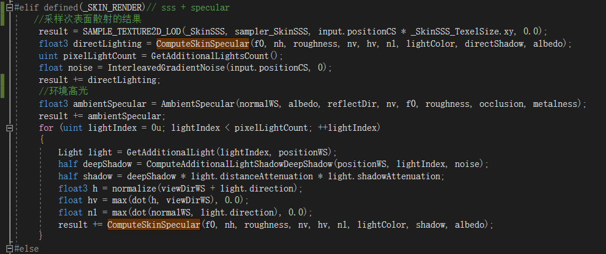

```hlsl
#elif defined(_SKIN_RENDER)// sss + specular
    //采样次表面散射的结果
    result = SAMPLE_TEXTURE2D_LOD(_SkinSSS, sampler_SkinSSS, input.positionCS * _SkinSSS_TexelSize.xy, 0.0);
    float3 directLighting = ComputeSkinSpecular(f0, nh, roughness, nv, hv, nl, lightColor, directShadow, albedo);
    uint pixelLightCount = GetAdditionalLightsCount();
    float noise = InterleavedGradientNoise(input.positionCS, 0);
    result += directLighting;

    //环境高光
    float3 ambientSpecular = AmbientSpecular(normalWS, albedo, reflectDir, nv, f0, roughness, occlusion, metalness);
    result += ambientSpecular;
    for (uint lightIndex = 0u; lightIndex < pixelLightCount; ++lightIndex)
    {
        Light light = GetAdditionalLight(lightIndex, positionWS);
        half deepShadow = ComputeAdditionalLightShadowDeepShadow(positionWS, lightIndex, noise);
        half shadow = deepShadow * light.distanceAttenuation * light.shadowAttenuation;
        float3 h = normalize(viewDirWS + light.direction);
        float hv = max(dot(h, viewDirWS), 0.0);
        float nl = max(dot(normalWS, light.direction), 0.0);
        result += ComputeSkinSpecular(f0, nh, roughness, nv, hv, nl, lightColor, shadow, albedo);
    }
#else
```

## 效果


---

## 附：原文参考链接

- [Importance Sampling of the Normalized Diffusion Profile](https://zero-radiance.github.io/post/sampling-diffusion/)（文中 C# 采样实现参考）
- HDRP / URP 次表面散射实现（Unity 官方源码）
- Pixar, *Approximate Reflectance Profiles for Efficient Subsurface Scattering*
- Steve McAuley, *Energy-Conserving Wrapped Diffuse*
- 《GPU Gems 3》Chapter 14.2 — Advanced Techniques for Realistic Real-Time Skin Rendering
