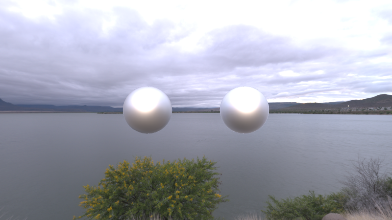
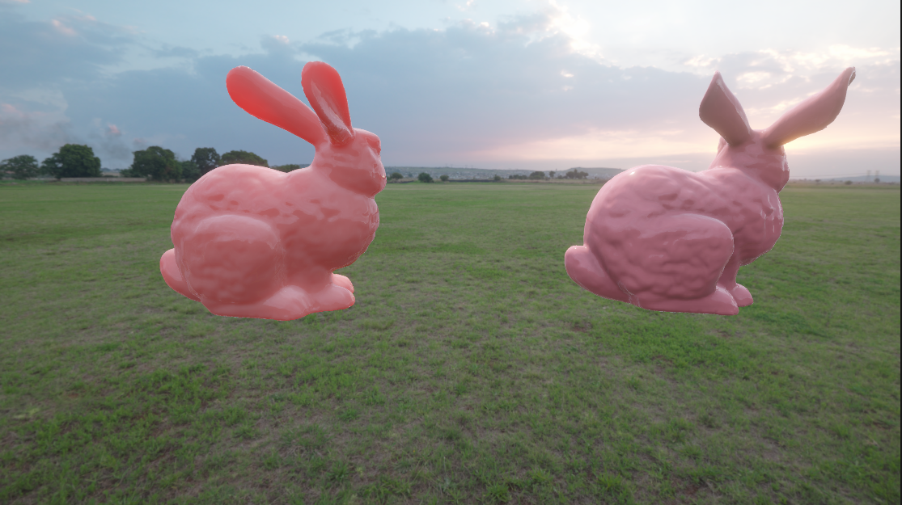
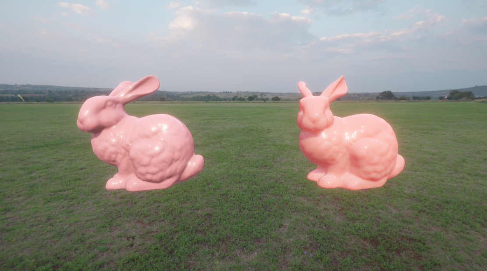
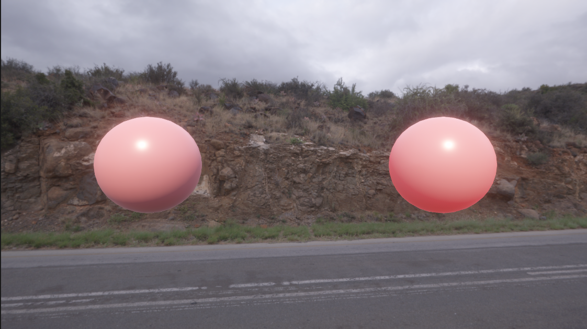

# Unity URP 自定义 PBR 与 SSS 渲染实践

基于 Universal Render Pipeline（URP）的两项渲染实践：**自定义 PBR 与 IBL**，探索直接光照、环境光照及烘焙；**屏幕空间次表面散射（SSS）与透射**，探索 Burley 扩散、厚度估计与前向合成。两个模块分别提供效果对比、实现代码与学习文档。

- [PBR 与 IBL](#pbr)：[效果](#pbr-preview) · [原理与功能](#pbr-features) · [实现结构](#pbr-structure) · [使用](#pbr-usage) · [学习文档](#pbr-docs)
- [SSS 与透射](#sss)：[效果](#sss-preview) · [原理与功能](#sss-features) · [实现结构](#sss-structure) · [使用](#sss-usage) · [学习文档](#sss-docs)
- [运行环境](#environment)

<a id="pbr"></a>
## PBR 与 IBL

从零手写、不依赖 Unity 内置 Lit Shader 的 PBR 实现，对比自定义 `MyPBR` 与 Unity 内置 PBR 材质。

<a id="pbr-preview"></a>
### 效果预览



左边球体为自定义 `MyPBR` 材质（Smoothness = 0.5，Metallic = 1），右边球体为 Unity 内置 PBR 材质，环境光照均来自同一张 HDRI（IBL）。

<a id="pbr-features"></a>
### 原理与功能

- **直接光照**：Cook-Torrance 微表面 BRDF，包含 GGX 法线分布（NDF）、Smith 几何遮蔽项（G）、Schlick Fresnel 近似（F）；采用金属度 / 粗糙度工作流。
- **间接漫反射**：支持暴力半球积分烘焙 Irradiance Cubemap，以及球谐函数（SH）投影 / 重构。SH 使用 9 个系数 × RGB 表达低频光照，运行时无需采样环境贴图。
- **间接镜面反射**：GGX 重要性采样预滤波环境贴图，按粗糙度分 mip；配合 BRDF LUT（`SpecularLut`）实现 Split-Sum 近似，运行时计算 `环境色 × (F0 × A + B)`。
- **编辑器工具**：`Tools/Capture Cubemap` 捕获环境；`Tools/IBLBaker` 烘焙 Irradiance Map、Prefiltered Specular Map 与 BRDF LUT；`SHBaker` 烘焙 9 个球谐系数 × RGB（不是 9 阶）。

<a id="pbr-structure"></a>
### 实现结构

```text
Assets/PBR/
├── MyPBR.shader                 自定义 PBR Shader（对比材质见 std.mat）
├── PBRLibrary/
│   ├── PBRMainLighting.hlsl     直接光 Cook-Torrance BRDF
│   ├── PBRIndirectLighting.hlsl 间接光：SH 重构 + 预滤波镜面反射 + BRDF LUT
│   └── IBLBakerCS.compute       IBL 烘焙用 Compute Shader
├── Script/
│   ├── IBLBaker.cs              IBL 烘焙工具窗口
│   ├── SHBaker.cs               球谐系数烘焙
│   └── CubemapCaptureWindow.cs  Cubemap 捕获工具
├── Textures/                   HDRI 与烘焙产物
└── Doc/                        原理推导与实现笔记
```

<a id="pbr-usage"></a>
### 使用流程

1. 将 HDRI 用于场景 Skybox，按需通过 `Tools/Capture Cubemap` 捕获 Cubemap。
2. 打开 `Tools/IBLBaker`，依次烘焙 Irradiance Map、Prefiltered Specular Map、BRDF LUT，并配置到自定义材质。
3. 如果使用球谐方案代替 Irradiance Map 采样，运行 `SHBaker` 烘焙 9 个球谐系数 × RGB，并在自定义 Shader 中配置使用。

<a id="pbr-docs"></a>
### 学习文档

| 文档 | 内容 |
| --- | --- |
| [PBR 核心指南](Assets/PBR/Doc/PBR_Reference.md) | Cook-Torrance BRDF 推导 |
| [IBL 间接漫反射](Assets/PBR/Doc/IBL_Reference.md) | 暴力烘焙与球谐投影，含数学推导 |
| [球谐函数原理](Assets/PBR/Doc/SphericalHarmonics_Reference.md) | 正交性、卷积定理、Light Probe 与局限性 |
| [预滤波环境贴图](Assets/PBR/Doc/IBL_Specular_Prefilter_Derivation.md) | 从渲染方程到代码 |
| [环境 BRDF](Assets/PBR/Doc/IBL_Specular_EnvBRDF_Derivation.md) | Split-Sum 第二项：从积分到 `F0*A+B` |
| [Compute Shader](Assets/PBR/Doc/ComputeShader_Reference.md) | 核心机制与 IBL 实践 |
| [IBL 抗走样](Assets/PBR/Doc/Aliasing_Reference.md) | 摩尔纹与立体角预滤波 |

<a id="sss"></a>
## SSS 与透射

基于 Burley Normalized Diffusion 的屏幕空间次表面散射，结合厚度贴图或 AutoThick 自动厚度估计实现背光透射，高光单独合成。

<a id="sss-preview"></a>
### 效果预览

**兔子模型对比（2026-11-05）**



后侧视角：左侧为开启 AutoThick 的自定义 `SSS/SSSLit` 材质，右侧为 Unity URP 标准 Lit 材质。可对比耳部透光与身体明暗过渡。



前侧视角：左侧为 Unity URP 标准 Lit 材质，右侧为开启 AutoThick 的自定义 `SSS/SSSLit` 材质。可对比表面高光、细节与整体光照表现。

两种材质的金属度、粗糙度设置相同；两张图中的 SSS 材质均开启 AutoThick（自动厚度估计）。截图用于效果对比，不代表物理精度验证。

**球体材质对比**



左边球体为 Unity 内置 Lit 材质，右边球体为自定义 `SSS/SSSLit` 材质。两者基础颜色相同；右边的光照经过次表面散射后，明暗交界更柔和，暗部透出红色，整体更“通透”。

<a id="sss-features"></a>
### 原理与功能

光线进入皮肤、玉石等材质后会在内部散射再射出。本实现将 BSSRDF 积分近似为屏幕空间邻域光照的加权滤波，详细推导见学习文档。

- **扩散剖面**：Burley Normalized Diffusion，$R(r) = \dfrac{e^{-r/d} + e^{-r/(3d)}}{8\pi d r}$，RGB 三通道各有散射距离 $d$。
- **重要性采样**：解析逆 CDF 生成半径，分层采样 + 黄金角分布角度；每像素随机旋转打散采样图案。
- **自适应样本预算**：根据屏幕覆盖面积分配样本，并受 `Max Filter Sample Num` 限制。$16.56\,d_{max}$ 用于估计样本预算，不是实际采样半径的硬截断。
- **双边权重与自归一化**：深度差计入三维距离 $r' = \sqrt{r^2 + \Delta z^2}$，减少跨深度漏光；除以有效样本权重和，缓解边缘变暗与通道偏色。
- **Pre & Post Scatter**：albedo 在滤波前后各乘 $\sqrt{\rho}$，兼顾颜色渗透与贴图细节；高光不参与散射。
- **透射与厚度**：厚度贴图红通道 × `Thickness (mm)` 提供厚度；启用 AutoThick 后，用主方向光空间的单层入口深度估计厚度，无有效深度时回退到贴图。透射项加入漫反射缓冲后一起滤波。
- **单位**：散射距离与厚度以毫米表示；AutoThick 将世界空间深度差乘 1000，按 1 Unity 单位 = 1 米使用。

<a id="sss-structure"></a>
### 实现结构

```text
AutoThick（可选，先生成主方向光入口深度）
    ↓
SSSDiffuse（MRT：漫反射 + 透射，乘 √albedo；散射参数；深度）
    ↓
SSSFilter（Burley 采样 + 双边权重 → _FilterRT）
    ↓
UniversalForward（滤波结果 × √albedo + 直接光高光 + 环境反射）
```

```text
Assets/SSS-TEST/
├── SSSShaderLibrary/
│   ├── SSSLit.shader            SSSDiffuse、前向合成与 SSSLightDepth Pass
│   └── SSSFilter.shader         屏幕空间 Burley 滤波
├── Script/
│   └── SSSRenderFeature.cs      分配 RT、自动测厚入口深度、绘制漫反射与滤波
├── SSSBurley/                   对照参考实现
├── Material/                    测试材质
├── LearnSSS/                    学习笔记与实现教程
└── Doc/Images/                  效果截图
```

<a id="sss-usage"></a>
### 使用流程

1. 在 URP Renderer 资源上添加 `SSS Render Feature`，`SSS Filter Shader` 选择 `Hidden/SSS/SSSFilter`。
2. 新建材质，Shader 选择 `SSS/SSSLit`，赋给模型。
3. 调整材质参数：
   - `Scatter Color`：RGB 散射距离比例（皮肤可从 `(1, 0.35, 0.2)` 开始）。
   - `Scatter Distance (mm)`：散射距离整体大小，结合模型尺寸调整。
   - `Thickness Map` / `Thickness (mm)`：厚度贴图与毫米缩放；`Transmission Tint`：透射颜色。
4. 调整 Feature 参数：
   - `Auto Thick`（代码字段 `AutoThick`）：启用主方向光单层入口深度估厚，在 `SSSDiffuse` 之前执行。
   - `Max Filter Sample Num`：每像素最大采样数；散射范围越大，通常需要更多样本。
   - `Pixel Num Per Sample`：每多少个像素分配一个样本，越小采样越密。

**已知局限**

- 屏幕空间滤波无法获取屏幕外、被遮挡区域的光照；相邻且深度接近的 SSS 物体可能互相渗光。
- AutoThick 仅支持主方向光的单层入口深度，不能可靠区分重叠物体或多层结构；不满足运行条件时使用厚度贴图。
- 尚未实现附加光源；低采样数下仍有噪点，需提高采样数或配合时域抗锯齿。

<a id="sss-docs"></a>
### 学习文档

| 文档 | 内容 |
| --- | --- |
| [SSS 实现教程](Assets/SSS-TEST/LearnSSS/SSS实现教程.md) | BSSRDF 到工程公式：蒙特卡洛、重要性采样、逆 CDF、双边权重、自归一化与 URP 实现 |
| [SSS 实现教程 2——透射效果](Assets/SSS-TEST/LearnSSS/SSS实现教程2——透射效果.md) | 透射效果的原理与实现 |
| [SSS 学习笔记](Assets/SSS-TEST/LearnSSS/SSS学习笔记.md) | BSSRDF、扩散剖面与屏幕空间近似 |
| [SSS 次表面散射](Assets/SSS-TEST/LearnSSS/SSS次表面散射.md) | 参考文章：Participating Media、BSSRDF、Normalized Diffusion |
| [Unity 实现 SSS 皮肤次表面散射](Assets/SSS-TEST/LearnSSS/Unity实现SSS皮肤次表面散射.md) | 参考文章：URP 下参考 HDRP 的皮肤 SSS 实现 |

<a id="environment"></a>
## 运行环境

- Unity + URP。
- IBL 烘焙需要支持 Compute Shader 的平台。
- AutoThick 需要支持 RFloat 渲染纹理；当前不支持立体相机路径，回退到厚度贴图。
