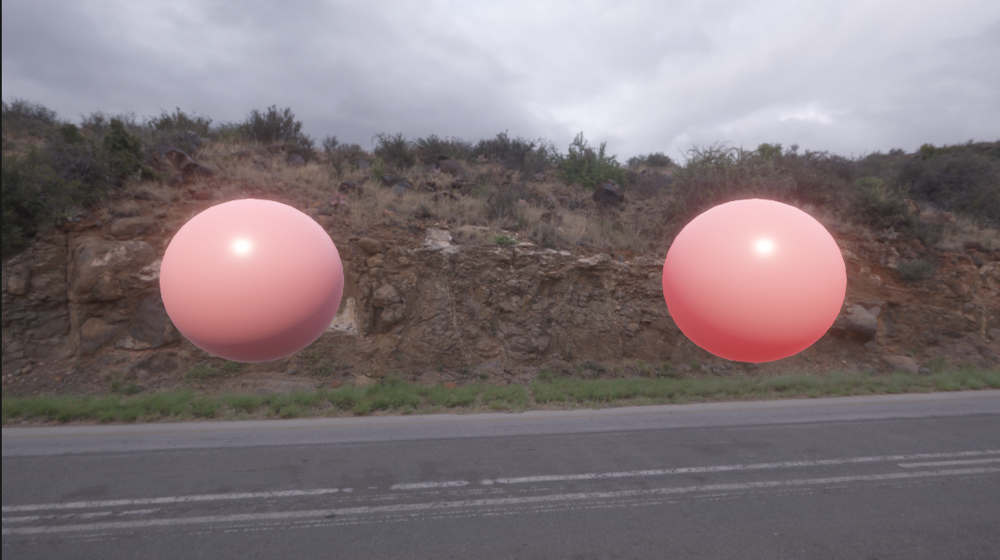

# MyPBR —— Unity URP 下手写的 PBR + IBL + 屏幕空间次表面散射

这是一套**从零手写**（不依赖 Unity 内置 Lit Shader）的物理基础渲染（PBR）实现，基于 Universal Render Pipeline (URP)。项目里同时对比了「自定义 PBR 材质」与「Unity 内置 PBR 材质」的渲染效果，并在此基础上实现了**屏幕空间次表面散射（Screen-Space Subsurface Scattering）**。

- [PBR + IBL](#效果预览)
- [屏幕空间次表面散射（SSS）](#屏幕空间次表面散射sss)

## 效果预览


左边球体为自定义 `MyPBR` 材质（Smoothness = 0.5，Metallic = 1），右边球体为 Unity 内置 PBR 材质，环境光照均来自同一张 HDRI（IBL）。

## 功能特性

### 直接光照（Direct Lighting）
- Cook-Torrance 微表面 BRDF：GGX 法线分布（NDF）、Smith 几何遮蔽项（G）、Schlick Fresnel 近似（F）
- 金属度 / 粗糙度（Metallic / Roughness）工作流

### 间接光照（IBL，Indirect Lighting）
- **漫反射部分**
  - 方法一：暴力半球积分烘焙 Irradiance Cubemap（Compute Shader，`IBLBakerCS.compute`）
  - 方法二：球谐函数（SH）投影/重构，仅用 9 个系数 × 3（RGB）还原低频漫反射光照，运行时零采样开销
- **镜面反射部分**
  - 预滤波环境贴图（Prefiltered Environment Map，按粗糙度分 mip 卷积 GGX 重要性采样）
  - Split-Sum 近似：预计算 BRDF LUT（`SpecularLut`），运行时 `环境色 × (F0 × A + B)`

### 编辑器工具
- `Tools/Capture Cubemap`：从场景/HDRI 捕获 Cubemap
- `Tools/IBLBaker`：一键烘焙 Irradiance Map / Prefiltered Specular Map / BRDF LUT
- `SHBaker`：烘焙球谐系数（9 阶 × RGB）

## 目录结构

```
Assets/PBR/
├── MyPBR.shader                 自定义 PBR Shader（对比用 Unity 内置材质见 std.mat）
├── PBRLibrary/
│   ├── PBRMainLighting.hlsl      直接光 Cook-Torrance BRDF
│   ├── PBRIndirectLighting.hlsl  间接光：SH 重构 + 预滤波镜面反射 + BRDF LUT
│   └── IBLBakerCS.compute        IBL 烘焙用 Compute Shader
├── Script/
│   ├── IBLBaker.cs                烘焙工具窗口（Irradiance / Prefilter / LUT）
│   ├── SHBaker.cs                  球谐系数烘焙
│   └── CubemapCaptureWindow.cs     Cubemap 捕获工具
├── Textures/                      HDRI 环境图、烘焙产物（IrradianceMap / SpecularMap / SpecularLut）
└── Doc/                           原理推导与实现笔记（见下）
```

## 文档

`Assets/PBR/Doc/` 下是完整的推导笔记，写代码前的数学原理、离散化过程都有详细推导：

| 文档 | 内容 |
| --- | --- |
| `PBR_Reference.md` | PBR 核心指南，Cook-Torrance BRDF 逆向手摸手推导 |
| `IBL_Reference.md` | IBL 间接漫反射：暴力烘焙 + 球谐投影两种方法，含完整数学推导附录 |
| `SphericalHarmonics_Reference.md` | 球谐函数（SH）原理深入指南：正交性、卷积定理、Light Probe、局限性 |
| `IBL_Specular_Prefilter_Derivation.md` | 预滤波环境贴图：从渲染方程到代码 |
| `IBL_Specular_EnvBRDF_Derivation.md` | 环境 BRDF（Split-Sum 第二项）：从积分到 `F0*A+B` 再到代码 |
| `ComputeShader_Reference.md` | Compute Shader 核心机制与 IBL 实践 |
| `Aliasing_Reference.md` | IBL 烘焙中的摩尔纹现象与立体角预滤波消除法 |

## 使用流程

1. 将 HDRI 贴图放入场景 / Skybox。
2. 打开 `Tools/IBLBaker`，依次烘焙 Irradiance Map、Prefiltered Specular Map、BRDF LUT。
3. 如果要用球谐方案代替 Irradiance Map 采样，运行 `SHBaker` 烘焙 9 阶球谐系数，并手动修改自定义材质shader。

## 屏幕空间次表面散射（SSS）



左边球体为 Unity 内置 Lit 材质，右边球体为自定义 `SSS/SSSLit` 材质。两者基础颜色相同；右边的光照经过次表面散射后，明暗交界更柔和，暗部透出红色，整体更"通透"。

### 原理概述

光线进入皮肤、玉石这类半透明材质后，会在内部散射一段距离再射出，所以一个像素的漫反射应该是**周围一圈像素漫反射光照的加权平均**。实现上把 BSSRDF 积分简化为屏幕空间的加权模糊：

- **扩散剖面**：Burley Normalized Diffusion，$R(r) = \dfrac{e^{-r/d} + e^{-r/(3d)}}{8\pi d r}$，RGB 三通道各有一个散射距离 $d$
- **积分方式**：蒙特卡洛 + 重要性采样，按剖面的逆 CDF 撒点，与 Unity HDRP 的 `SubsurfaceScattering.compute` 思路一致
- **高光不参与散射**：高光在表面直接反射，单独计算后与散射结果相加

### 渲染流程

```
SSSDiffuse Pass（MRT）           SSSFilter（全屏）                UniversalForward Pass
漫反射光照 × √albedo  ─┐
散射距离 d + 遮罩     ─┼──→  Burley 圆盘采样 + 双边权重  ──→  散射结果 × √albedo + 高光
深度                  ─┘          （_FilterRT）
```

1. **SSSDiffuse**：由 Renderer Feature 用自定义 LightMode 绘制，MRT 同时输出漫反射光照（主光源 + 球谐环境光，扣除菲涅尔反射部分）与散射参数
2. **SSSFilter**：每个像素在以自身为圆心的圆盘内采样邻居像素，按 Burley 剖面加权求和
3. **合成**：SSS 材质的前向 Pass 读取滤波结果，乘以剩余的 albedo，再加上直接光高光与环境反射

### 功能特性

- **Burley 剖面重要性采样**：解析逆 CDF 生成采样半径，分层采样 + 黄金角分布角度
- **每像素随机旋转**：Interleaved Gradient Noise 打散采样图案，避免规律性条纹
- **自适应采样数**：按散射圆盘在屏幕上覆盖的像素面积决定采样数，并设上限（`Max Filter Sample Num`）
- **双边权重**：深度差计入三维距离 $r' = \sqrt{r^2 + \Delta z^2}$，深度断崖处权重自然衰减，减少漏光
- **自归一化**：除以有效样本的权重和，物体边缘不变暗、各通道不偏色
- **Pre & Post Scatter 纹理模式**：albedo 在模糊前后各乘 $\sqrt{\rho}$，在颜色渗透与贴图细节之间折中
- **物理单位**：散射距离以毫米为单位，根据深度与投影矩阵换算为屏幕像素

### 目录结构

```
Assets/SSS-TEST/
├── SSSShaderLibrary/
│   ├── SSSLit.shader            SSS 材质：SSSDiffuse Pass（漫反射 + 参数）与前向合成 Pass（散射结果 + 高光）
│   └── SSSFilter.shader         屏幕空间散射滤波（Burley 圆盘重要性采样）
├── Script/
│   └── SSSRenderFeature.cs      Renderer Feature：分配 RT、绘制 SSSDiffuse、执行滤波
├── SSSBurley/                   对照参考实现（同一思路的另一版本）
├── Material/                    测试材质
├── LearnSSS/                    学习笔记与实现教程（见下）
└── Doc/Images/                  效果截图
```

### 文档

`Assets/SSS-TEST/LearnSSS/` 下是学习过程中整理的理论与实现文档：

| 文档 | 内容 |
| --- | --- |
| `SSS实现教程.md` | 从 BSSRDF 积分到工程公式的完整推导（蒙特卡洛、重要性采样、逆 CDF、双边权重、自归一化），以及 URP 下逐步实现 |
| `SSS学习笔记.md` | BSSRDF 拆解、Diffuse Profile 演进、HDRP / UE 的取舍、屏幕空间 SSS 的近似 |
| `SSS次表面散射.md` | 参考文章：Participating Media、BSSRDF、Normalized Diffusion 理论 |
| `Unity实现SSS皮肤次表面散射.md` | 参考文章：URP 下参考 HDRP 的皮肤 SSS 实现 |

### 使用流程

1. 在 URP Renderer 资源上添加 `SSS Render Feature`，`SSS Filter Shader` 选择 `Hidden/SSS/SSSFilter`
2. 新建材质，Shader 选择 `SSS/SSSLit`，赋给模型
3. 调整材质参数：
   - `Scatter Color`：RGB 三通道散射距离的比例，决定颜色偏移（皮肤可用 `(1, 0.35, 0.2)` 左右）
   - `Scatter Distance (mm)`：散射距离的整体大小。滤波半径约为 $16.56\,d_{max}$，应明显小于物体尺寸
4. 调整 Feature 参数：
   - `Max Filter Sample Num`：每像素最大采样数。散射距离越大越需要更多采样，否则会出现网格状噪点
   - `Pixel Num Per Sample`：每多少个像素分配一个样本，越小采样越密

### 已知局限

- 屏幕空间方法无法处理屏幕外、被遮挡区域的光照
- 只区分"是否为 SSS 像素"，屏幕上相邻且深度接近的两个 SSS 物体之间可能互相渗光
- 尚未实现透射（Transmission，薄处背光透红）与附加光源
- 采样数较少时有噪点，需提高采样数或配合 TAA

## 环境

- Unity + URP
- 需要支持 Compute Shader 的平台（用于 IBL 烘焙）
