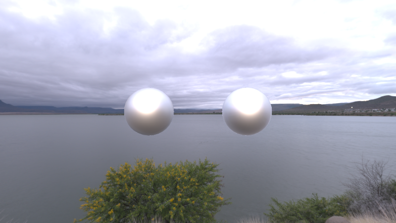

# MyPBR —— Unity URP 下手写的 PBR + IBL 渲染管线

这是一套**从零手写**（不依赖 Unity 内置 Lit Shader）的物理基础渲染（PBR）实现，基于 Universal Render Pipeline (URP)。项目里同时对比了「自定义 PBR 材质」与「Unity 内置 PBR 材质」的渲染效果。

## 效果预览



左边球体为自定义 `MyPBR` 材质（Smoothness = 0.5，Metallic = 1），右边球体为 Unity 内置 PBR 材质，环境光照均来自同一张 HDRI（IBL）。

## 功能特性

### 直接光照（Direct Lighting）
- Cook-Torrance 微表面 BRDF：GGX 法线分布（NDF）、Smith 几何遮蔽项（G）、Schlick Fresnel 近似（F）
- 金属度 / 粗糙度（Metallic / Roughness）工作流

### 间接光照（IBL，Indirect Lighting）
- **漫反射部分**
  - 方法一：暴力半球积分烘焙 Irradiance Cubemap（Compute Shader，`IBLBakerCS.compute`）
  - 方法二：球谐函数（SH）投影/重构，仅用 9 个系数 × 3（RGB）还原低频漫反射光照，运行时零采样开销
- **镜面反射部分**
  - 预滤波环境贴图（Prefiltered Environment Map，按粗糙度分 mip 卷积 GGX 重要性采样）
  - Split-Sum 近似：预计算 BRDF LUT（`SpecularLut`），运行时 `环境色 × (F0 × A + B)`

### 编辑器工具
- `Tools/Capture Cubemap`：从场景/HDRI 捕获 Cubemap
- `Tools/IBLBaker`：一键烘焙 Irradiance Map / Prefiltered Specular Map / BRDF LUT
- `SHBaker`：烘焙球谐系数（9 阶 × RGB）

## 目录结构

```
Assets/PBR/
├── MyPBR.shader                 自定义 PBR Shader（对比用 Unity 内置材质见 std.mat）
├── PBRLibrary/
│   ├── PBRMainLighting.hlsl      直接光 Cook-Torrance BRDF
│   ├── PBRIndirectLighting.hlsl  间接光：SH 重构 + 预滤波镜面反射 + BRDF LUT
│   └── IBLBakerCS.compute        IBL 烘焙用 Compute Shader
├── Script/
│   ├── IBLBaker.cs                烘焙工具窗口（Irradiance / Prefilter / LUT）
│   ├── SHBaker.cs                  球谐系数烘焙
│   └── CubemapCaptureWindow.cs     Cubemap 捕获工具
├── Textures/                      HDRI 环境图、烘焙产物（IrradianceMap / SpecularMap / SpecularLut）
└── Doc/                           原理推导与实现笔记（见下）
```

## 文档

`Assets/PBR/Doc/` 下是完整的推导笔记，写代码前的数学原理、离散化过程都有详细推导：

| 文档 | 内容 |
| --- | --- |
| `PBR_Reference.md` | PBR 核心指南，Cook-Torrance BRDF 逆向手摸手推导 |
| `IBL_Reference.md` | IBL 间接漫反射：暴力烘焙 + 球谐投影两种方法，含完整数学推导附录 |
| `SphericalHarmonics_Reference.md` | 球谐函数（SH）原理深入指南：正交性、卷积定理、Light Probe、局限性 |
| `IBL_Specular_Prefilter_Derivation.md` | 预滤波环境贴图：从渲染方程到代码 |
| `IBL_Specular_EnvBRDF_Derivation.md` | 环境 BRDF（Split-Sum 第二项）：从积分到 `F0*A+B` 再到代码 |
| `ComputeShader_Reference.md` | Compute Shader 核心机制与 IBL 实践 |
| `Aliasing_Reference.md` | IBL 烘焙中的摩尔纹现象与立体角预滤波消除法 |

## 使用流程

1. 将 HDRI 贴图放入场景 / Skybox。
2. 打开 `Tools/IBLBaker`，依次烘焙 Irradiance Map、Prefiltered Specular Map、BRDF LUT。
3. 如果要用球谐方案代替 Irradiance Map 采样，运行 `SHBaker` 烘焙 9 阶球谐系数，并手动修改自定义材质shader。
## 环境

- Unity + URP
- 需要支持 Compute Shader 的平台（用于 IBL 烘焙）
